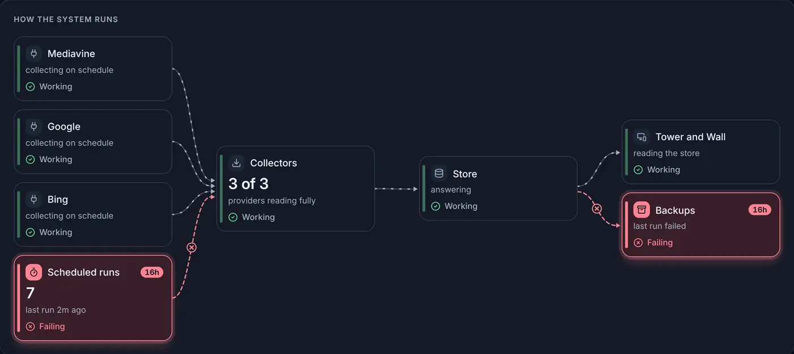
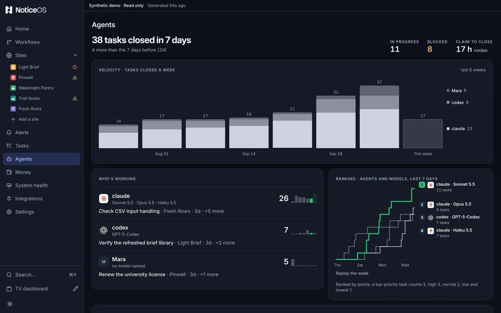

# NoticeOS

[](https://www.notice.cx/bay-window.webp)

<div align="center">

## Your startup. In clear view.

**A self-hosted app for your websites and software products.**<br>
See traffic, revenue, costs, alerts and work in one place, on your laptop, phone or TV.

[](https://github.com/notice-cx/NoticeOS/actions/workflows/ci.yml)
[](LICENSE)
[](https://www.typescriptlang.org/)
[](https://react.dev/)
[](https://www.postgresql.org/)
[](https://www.dolthub.com/)
[](deploy/compose/README.md)

**[Documentation](https://docs.notice.cx/)** · **[Install](#install-with-docker)** · **[Try the demo](docs/start/try-the-demo.md)** · **[Contribute](CONTRIBUTING.md)**

</div>


- **Know what needs attention.** See collection failures, unusual traffic and missing evidence.
- **See what makes money.** Compare recorded revenue and costs, with dates and coverage kept visible.
- **Keep work moving.** Track owners, blockers, approvals and completion evidence across projects.
- **Check what changed.** Review the follow-up evidence for a change. Completing work is not proof of a better outcome.

The **Tower** is the web app. **Wall** is its TV view.
Missing data is shown as unknown, never as zero.

## How it works


NoticeOS runs on your own machine as one Docker Compose stack. It reads each
source on a schedule, receives the nightly report your own product sends,
raises an alert when a day is unlikely to be normal, and keeps every row it
stores. [How NoticeOS works](https://docs.notice.cx/concepts/how-noticeos-thinks)
describes the loop that uses those readings.

## The Tower and the Wall

Every screenshot here is the [demo](docs/start/try-the-demo.md): the real app
with five invented sites and a simulator that keeps adding activity.

<table>
<tr>
<td width="50%"><br><b>Tasks</b>: one board for people and agents. An epic is drawn as a graph of what blocks what.</td>
<td width="50%"><br><b>System health</b>: how the System runs, with each part's state and the broken part outlined.</td>
</tr>
<tr>
<td width="50%"><br><b>Money</b>: revenue − cost = net for the month, by day and by site.</td>
<td width="50%"><br><b>Agents</b>: who closed what, with which model, week by week.</td>
</tr>
</table>


The **Wall** fits one 1920×1080 screen and updates by itself. More screens are
in [the Tower's documentation](https://docs.notice.cx/tower/).

## Install with Docker

With only Docker on the machine (Docker Desktop or Docker Engine, on
linux/amd64 or linux/arm64), one line sets up a new installation:

```sh
docker run --rm ghcr.io/notice-cx/noticeos:main launcher | sh -s -- setup
```

Open **[http://127.0.0.1:5173/](http://127.0.0.1:5173/)**. Setup makes the
installation folder `~/noticeos` with its own secrets and starts Postgres, the
Dolt task database, the app and its backup worker as one Docker Compose stack, from
main's newest published image. The folder's launcher runs its commands:
`~/noticeos/noticeos status`, `logs`, `apply`, `update`.
[Install with Docker](docs/start/install-with-docker.md) covers the options,
the commands and updates.

## Run from source

To work on NoticeOS or build its image yourself, the machine needs:

| Requirement | Version or setup |
| --- | --- |
| Node.js | 24.21.0 LTS |
| pnpm | 12.8.1 |
| Docker | A running local engine with Docker Compose |

From a clone on `main`:

```sh
pnpm install --frozen-lockfile
pnpm os:setup
```

Open **[http://127.0.0.1:5173/](http://127.0.0.1:5173/)**. Setup fetches the app
image published for `main` (or builds it when none is published), makes the
installation folder `~/noticeos` with its own secrets, starts
Postgres, the Dolt task database, the app and its backup worker as one Docker Compose
stack, and points the `pnpm os:*` commands at it. It starts with no user
websites or provider accounts, and existing databases are never changed.

[Install from source](docs/start/install-from-source.md) covers the options;
[Run with Docker](docs/start/run-with-docker.md) covers the folder, changing a
setting with `pnpm os:apply`, moving a legacy installation into it with
`pnpm os:convert-legacy`, and updates. For an
existing installation, read the [upgrade policy](docs/reference/release-policy.md)
before changing its code or database.

## Get your first useful view

1. On **Home**, choose **Add your first site**.
2. Open the site's **Data sources** tab and connect a source.
3. Open **Overview** to see its first readings. Use **Tasks** for work and **Wall** for the TV view.

Add provider credentials in the product, where they are encrypted in the store.
Products that send their own metrics use the [report contract](docs/02-signal-contract.md)
and [bootstrap credential setup](docs/06-operations.md#bootstrap-secrets-vs-integration-credentials).

## One shared place for work

**Beads provides the task model; Dolt stores the tasks in one central database.**
People and agents coordinate the same tasks across NoticeOS and the projects
it manages, with status, ownership, dependencies, approval gates and evidence.
New installations include a NoticeOS task project, so Tasks works before you
add a website. [Connect a task project](docs/guides/connect-a-task-project.md) covers
a project's shared tasks, repository access and agent instructions.

People work on the **Tasks** page. A coding agent such as Claude Code reaches
the same tasks, and the site reports, through the MCP server the Tower serves
at `/api/mcp`; [Connect an agent](docs/guides/connect-an-agent.md) shows how to
set it up with one command. Installable agent skills and hooks, and connections
to tools such as Jira or Linear, are planned; they are not available yet.

## Deployment status

| Installation | Use it for |
| --- | --- |
| [Standalone](#install-with-docker) | Your own assets, on a trusted network |
| [Docker stack](deploy/compose/README.md) | A prepared installation that keeps running in the background, from an image or a checkout's live source, controlled with `pnpm os:*` or its folder's `noticeos` launcher |
| [Docker demo preview](deploy/demo/README.md) | A shared, read-only demo with synthetic assets and ongoing simulated activity |

Standalone has no user login: anyone who can reach it can operate it. Keep it
behind an access proxy, VPN or private network.

The demo package runs the built app, Postgres and Dolt on a Linux server or VM,
including Proxmox. Put its application port behind an HTTPS reverse proxy.
Visitors explore the same product and task model; they cannot change data or
connect real providers. Follow the demo guide for setup, updates and recovery.

Customer account hosting and invitation-based onboarding are not part of this
preview release. Checks that pass on a local machine do not show that a public
deployment works. See the [workspace ownership contract](docs/23-configuration-ownership.md),
[security policy](SECURITY.md) and [release policy](docs/reference/release-policy.md).

## Contribute

Read [CONTRIBUTING.md](CONTRIBUTING.md) for the code map, isolated tests and
review process. Use the public repository's issues and pull requests when
available; access to the maintainers' private task database is not required.
Report vulnerabilities privately through [SECURITY.md](SECURITY.md).

Useful references: [design docs](docs/README.md) · [operations](scripts/README.md) ·
[repository instructions](AGENTS.md).

## License

Copyright © 2026 Reindex Ventures LLC.

[GNU Affero General Public License, version 3](LICENSE) (`AGPL-3.0-only`).
See [third-party notices](THIRD_PARTY_NOTICES.md) for bundled software and assets.
