# Alerts

This page covers what an alert on the **Alerts** page means, when one fires, and what happens when you mark it read, snooze, resolve or tune it.

## What an alert is

An alert is a record that a number on a site is unlikely to be normal, with the evidence attached. Every alert shows the site, the metric, what happened, and the rule and inputs that produced it. The evidence on any alert opens to the actual numbers.

On `example.com`, an alert might read: "Recipes saved: 0 in the last 24 hours (average 6.2 a day)". The evidence shows the week it was compared against and how unlikely a zero day was.

Alerts come from the nightly reports a site sends about itself, from the data sources NoticeOS collects centrally, and from NoticeOS's checks on its own collection. A nightly report that stops arriving raises an alert too.

## Severity and kind

Every alert carries two separate labels.

**Severity** marks how urgent it is.

- **Error**: something is broken or missing. `example.com` has stopped sending its nightly report.
- **Warning**: a number moved in a way that is unlikely to be chance. Recipes saved dropped to zero against a baseline of six a day.
- **Info**: worth knowing, nothing to do. An outcome check closed with no clear change.

**Kind** marks what sort of news it is.

- **Anomaly**: a number moved in a way it should not have. Most alerts are anomalies.
- **Opportunity**: good news that may deserve action. An outcome check that confirmed an improvement raises one.
- **Milestone**: a number reached a set level. A milestone is always info severity, so it is never urgent.

The two labels are kept separate so you can filter by each one on its own. The **Open** list shows warnings and errors; the **History** tab holds everything, including info alerts.

## When an alert fires

NoticeOS does not use fixed thresholds like "warn when sign-ups drop 50%". On a small site a 50% drop happens on an ordinary low-traffic Tuesday. After a stream of false alarms, people stop reading the page, which is worse than having no page.

Instead, a count-type metric is tested over a window of whole days, and fires when the count in that window is unlikely:

1. **The window is as short as the volume allows.** NoticeOS uses the fewest whole days in which a run of zeros would be unlikely enough to alert on. A metric that averages 4.6 or more a day is tested one day at a time. Quieter metrics are tested over more days: 3 a day over two days, 1.5 a day over four, 1 a day over five, 0.5 a day over ten. The longest window is 14 days, so a metric under 0.33 a day is not tested.
2. **The count in the window is unlikely given the recent past.** NoticeOS compares the window with four earlier windows of the same length that end on the same weekday, and calculates how probable a count this low would be if nothing had changed. If that probability is under the sensitivity setting (1 in 100 by default), the alert fires. If there is not enough history to compare against yet, NoticeOS raises no alert instead of guessing.

So on `example.com`, recipes saved at 6.2 a day falling to 0 fires on the first day: a zero day there has a probability of about 1 in 500. Newsletter sign-ups at 1.5 a day are tested over four days. Four days with no sign-ups fire: at that rate they have a probability of about 1 in 400. One, two or three empty days do not.

A day that a data source has not finished reporting is never tested. If a source has not reported yet, its missing rows are not counted as zeros.

The rule and its two settings are described for people in [doc 02, The signal contract](../02-signal-contract.md).

## The four actions on an alert

Each open alert has four actions. None of them deletes anything; the evidence stays.

- **Mark read**: "I have seen this". The alert leaves the open list. If the same condition fires again later, you get a new alert.
- **Snooze**: "not now". Pick a date within the next 90 days. The alert leaves the open list and is listed under **Snoozed**, and the same alert, with the same evidence, comes back on that date. **Unsnooze** brings it back early.
- **Resolve**: "the underlying issue is fixed". The alert is finished.
- **Tune**: "this rule raises too many alerts". Tune opens the two settings behind the rule, shows what each value would have fired on real past days, and saves your change. A tuned alert stays open, because tuning changed the rule, not the condition.

Beside the actions there is **File task**, which creates a task on the site's project with the alert attached, so the work and the alert stay linked. See [Tasks and agents](/concepts/tasks-and-agents).

Some conditions recur every day while they last, for example a nightly report that keeps failing. These show as one row, and acting on the row acts on the whole condition rather than one night of it.

## What "settled" means

An alert is **settled** when it will not come back: you resolved it, or you marked it read. The Alerts page shows a count of alerts settled in the last seven days.

A snoozed alert is not settled. Nobody has decided anything about it yet; it is hidden until its return date. A tuned alert is not settled either, because it is still open.

Settled alerts are listed in **History** with the decision you made and when.

## Recovery

When a number returns to normal on its own, the alert for it closes and the site stops showing the old warning. NoticeOS never reopens a decision you made. If the condition returns, that is a new alert.

## Two settings, on purpose

The whole rule is two numbers, visible under **Settings** and inside **Tune**:

- **Anomaly sensitivity**: lower means fewer alerts, each less likely to be a false alarm. A lower sensitivity also lengthens each metric's window.
- **Longest window**: the most days a quiet metric is pooled over. A longer window tests quieter metrics, and shows their drops later.

There are no per-metric thresholds to maintain. If the page shows too many alerts, tune these two and look at the replay before you save.

## Related

- [Alerts](/tower/alerts), the screen
- [How NoticeOS works](/concepts/how-noticeos-thinks)
- [Send your own report](/guides/send-your-own-report)
- [Settings](/tower/settings)
