# Attribution and measurement

This page covers how NoticeOS measures whether a change had any effect, and what you need to do to make that measurement possible.

## A change shipped is not a result

Suppose you rewrite the titles on 200 recipe pages on `example.com` on the 3rd. On the 20th, clicks from Google are up 8%. Did the titles do that?

Maybe. Or Google shipped an update on the 10th. Or it is the week before a holiday. An 8% move on an asset this size is within normal day-to-day variation, and the chart does not show which cause it was.

NoticeOS does not record "the titles earned 8%" based on a chart. A change is credited with an effect only when the comparison was set before the numbers existed, and the numbers then passed it. Everything else is recorded as shipped, with the result unmeasured.

This is stricter than most tools, on purpose. A system that credits every change with whatever happened next records wrong results and bases later decisions on them. The reasoning is in [doc 03, Attribution](../03-attribution.md).

## The outcome check

The tool NoticeOS gives you today is the **outcome check**, registered from an asset's **Activity** tab. You set it up before, or right after, a change ships, and NoticeOS reads it on fixed days afterwards.

An outcome check records:

- **The change** it belongs to: a change you logged on the Activity tab, or a short name for something else.
- **The metric**: a series from Google Analytics, Search Console or Bing, such as Search Console clicks.
- **The scope**: the whole asset, one search query, or one page. An average such as search position must be scoped, because an asset-wide average moves whenever the mix of queries moves.
- **The baseline**: how many days before the change to compare against.
- **The check days**: when to read it, for example 7, 14 and 28 days after.
- **The thresholds**: what counts as an improvement and what counts as a decline, as a percent change in a stated direction.
- **The task** that receives the verdict.

On the final check day, NoticeOS compares the days after the change with the baseline and closes the check with one of four verdicts:

- **Improvement confirmed**: the improvement threshold was met.
- **Decline confirmed**: the decline threshold was met. This one raises a warning alert.
- **No clear change**: neither threshold was met, or no thresholds were set. The numbers are shown.
- **Could not be measured**: the baseline was empty, too many days were missing, or the archive has no data for the scope.

The checks before the final one are interim readings. They show the numbers and close nothing.

The verdict is posted as a comment on the task you named, so the result is recorded on the task that caused the change.

## What a measurement window is

The baseline days plus the check days are the measurement window. While a window is open, the surfaces it measures should stay unchanged. If you rewrite those same 200 titles again on day 12, the check on day 14 can no longer separate the effect of one rewrite from the other. Log the second change and register a fresh check instead.

## Choosing a threshold

A threshold is a prediction you set in advance. If it is too low, normal variation is recorded as an improvement. When you register a check, the composer shows the asset's typical day-to-day movement for that metric over the recent past, excluding days that cross a change you logged, so you can set the threshold above that variation. If there is not enough history to calibrate, the composer shows that, and a starting value of 10% is marked as uncalibrated.

## Holdouts

A holdout is a slice you deliberately leave unchanged so you have something to compare against. If you change the titles on 180 of the 200 recipe pages and leave 20 alone, the 20 are the holdout. If the 180 go up and the 20 do not, you have a reason to credit the titles; if all 200 go up together, something else caused the rise.

NoticeOS does not pick a holdout for you today, and no automated process may change which pages are held out. You choose the slice, change the rest, and register scoped outcome checks on each.

## Cohorts

A cohort is a group of comparable pages treated as one unit, so that a change applied to the whole group can be measured against another group like it. On `example.com`, the 200 recipe pages might be split into two groups of 100 with similar traffic, one changed and one not. This is the strongest evidence an asset can produce for a template-level change, and it needs hundreds of similar pages and a fair amount of traffic.

NoticeOS does not assign cohorts today. If you split pages yourself, register one outcome check per group and read them side by side.

## Why some things stay unmeasured

Most single changes on an asset under 100,000 visits a month are too small to measure on their own. A new paragraph, a fixed link, a nicer button: each may help, and none will move a chart beyond its normal variation. NoticeOS records these as shipped and unmeasured, with no value claimed.

The effect of each such change is smaller than the normal variation in the numbers. Small changes can be credited as a group, over a quarter, when their combined effect is measurable. A precise figure for each change would be invented.

A verdict of "could not be measured" means the data was not enough to reach a result; it does not mean the change did nothing.

## Your part in it

Four things on your side make a measurement possible: the change is logged on the asset's Activity tab the day it ships, with a reference such as the commit or the task id; an outcome check is registered against it, with its metric, scope, baseline, check days, thresholds and the task that receives the result; the surfaces stay untouched until the final check day; and the verdict is read on the task, or on the Alerts page if it was a decline.

Without the logged change there is nothing to attribute to; NoticeOS does not add a cause after the fact.

## Related

- [Portfolio](/tower/sites), where the Activity tab is
- [Tasks and agents](/concepts/tasks-and-agents)
- [How NoticeOS works](/concepts/how-noticeos-thinks)
- [Alerts](/concepts/alerts)
