# How NoticeOS works

Every screen in NoticeOS is part of the one loop this page describes.

## One loop, five steps

NoticeOS is built to improve the return on a set of websites, and to need less of your attention for each kind of change once changes of that kind have a record of predictions that came true. It does this by running one loop, over and over.

Take `example.com`, a recipe site whose revenue comes from ads.

1. **Sense.** Every night `example.com` sends NoticeOS a short report of the counts its own servers recorded: recipes saved, newsletter sign-ups, comments. NoticeOS also collects the site's data from outside services: Google Analytics, Search Console, Bing, ad revenue. All of it is saved in one store, by site and by day.
2. **Attribute.** When something changes on the site, NoticeOS checks whether the numbers moved because of that change, or for some other reason. It records "yes" only when the comparison shows it. Otherwise it records "could not be measured".
3. **Decide.** The things worth doing next are ranked by what they are likely to earn, in money, against what they cost, including your own time.
4. **Act.** A change gets built, checked by someone other than the builder, and shipped. Today you do the shipping. NoticeOS tracks the task, the change and the outcome check that follows.
5. **Learn.** The difference between what a change was expected to earn and what it did earn is an input to the next decision. A site whose predictions keep coming true is allowed more automation; a site whose predictions miss gets more review.

The order matters. A tool that only collects data and proposes changes has no record of whether its proposals worked. The loop is complete only when each outcome is recorded and used in the next decision.

The full design is in [doc 01, Architecture](../01-architecture.md) and the money model in [doc 00, Objective and ROI](../00-objective-and-roi.md).

## What you see of the loop

Each step appears in the Tower, NoticeOS's web app.

- **Sense** is the **Sites** list, a site's **Overview**, **Growth** and **Search** tabs, and **Alerts**.
- **Attribute** is a site's **Activity** tab, where you log a change and register an outcome check against it.
- **Decide** and **Act** are **Tasks**: one shared board where you, your team and your AI agents see the same work.
- **Learn** is the verdict on each outcome check, posted back to the task that caused the change.
- **Money** is the ledger, the record everything else is measured against.

## The ledger

The ledger is the one place NoticeOS records money. It has two kinds of row: revenue and cost, per site, per month. Ad revenue arrives through a connected ad network; other revenue and your costs arrive as uploaded exports.

A row, once written, never changes. If an ad network restates July after the payout clears, NoticeOS writes a new row that replaces the old one and keeps both. Both the figure recorded at the time and the corrected figure stay visible.

**Money** shows this ledger month by month, as revenue and **Net P&L**. The current month is marked "Month to date" because its figures are not final yet.

Traffic, rankings and sign-ups are not in the ledger. They are inputs that may lead to money. NoticeOS does not count them as results, because the most visited page on `example.com` is not always the one that brings in the most revenue.

## An unknown number is never recorded as zero

When NoticeOS has no value for a number, it shows the number as unknown instead of writing zero.

- A day Google has not finished counting is shown hollow and labelled as still counting. It is not an alert.
- A nightly report that did not arrive raises an error alert. The missing day stays blank; it is not a day with no sign-ups.
- A search query Google did not report for a day is a missing row, not a day with no clicks.
- A change whose effect cannot be told apart from noise is recorded as "could not be measured". It is never recorded as "worked" or "did nothing".

This is why some screens show "unknown" or "could not be measured" where another tool would show a precise-looking figure. That figure would be invented, and a system that chooses its changes by invented figures gets steadily worse while reporting success.

## What NoticeOS never touches on its own

Some parts of a site are off limits to automation, permanently. No record of correct predictions makes them eligible for automation. They are:

- sign-in and accounts
- billing
- security headers
- database migrations
- consent banners and privacy surfaces
- analytics and tracking code
- which pages are held out of experiments
- the thresholds the guardrails use

The last three are what results are measured with. If the system being measured could edit how it is measured, it would eventually do so. So only you can change them.

Today, in addition, no change to any site ships through NoticeOS without a person merging it. AI agents can read, file tasks and propose; the merge is yours. See [Tasks and agents](/concepts/tasks-and-agents).

## What this means for you

- Expect alerts to be rare and specific. When there are no alerts, usually nothing unusual happened; the checks still ran. See [Alerts](/concepts/alerts).
- Expect "could not be measured" to be a normal result, especially on a smaller site. See [Attribution and measurement](/concepts/attribution-and-measurement).
- Expect the number at the top of the page to be money, and the traffic figures to be below it.
- Expect to be the one who ships. NoticeOS prepares, tracks and checks; it does not merge.

## Related

- [Alerts](/concepts/alerts)
- [Attribution and measurement](/concepts/attribution-and-measurement)
- [Tasks and agents](/concepts/tasks-and-agents)
- [Money](/tower/financials)
