# Tasks and agents

This page covers the **Tasks** page, how a piece of work stays linked to its cause and its result, and what AI agents may and may not do.

## One shared task board

NoticeOS keeps one task database. Every site gets its own project in it, and the **System** (this installation's own NoticeOS) has one too. People and AI agents file, claim, comment on and close tasks in the same place, with the same fields: status, priority, owner, what blocks what, and the evidence that closed it.

The **Tasks** page shows all projects together. At the top is **Your decisions**: decisions that only you can make. Under it, **Next up** is work that is ready with nothing blocking it, then **Urgent**, **Blocked** and **Closed this week**. Filters narrow it by project, status, priority, label and owner, and any task opens to its history and comments.

A site's own **Tasks** tab shows the same board narrowed to that site.

On `example.com`, the project might hold "Rewrite recipe titles", "Fix broken ingredient links" and a review of last week's search rankings that NoticeOS filed automatically.

## Projects

A project is the task list for one site. You add one under **Settings** > **Task projects** by choosing the site and a short prefix; every task id in that project starts with the prefix, so "ex-14" is plainly `example.com`'s fourteenth task. A site with no project shows "No task project for this site" on its Tasks tab until you add one.

The steps for connecting a project are in [Connect a task project](/guides/connect-a-task-project).

## Owners and gates

Every task has an owner, which may be a person or an agent. An agent claims a task before starting it, so the board always shows who is working on what. When an agent names its model as it files, claims or closes a task, the task records the model too, and the **Agents** page counts the claimed and closed work under both the agent and the model.

Some steps only you can do: a credential, a decision, a step in an admin console. Those tasks carry a **human** label and appear under **Your decisions**, where you record your answer. An agent that needs you to pick one option files the options with the task; your pick, or your answer, is recorded on the task and returns it to ready work for an agent, and a task of type decision closes on it.

When a step must block until you approve it, the task carries a **gate**. A gated task leaves the ready list and stays out of it until you resolve the gate. An agent may ask for your approval by opening a gate, but only you resolve one: approval is never something an agent assumes.

## The key that links a finding to its outcome

The reason NoticeOS runs its own task board, instead of linking to a ticket tool, is this chain. The same key is carried unchanged through every step, so a change and the finding that led to it stay linked.

1. **A finding appears** on `example.com`'s site page, say a query that lost its ranking, or an alert. Every such card has a **File task** button.
2. **File task creates the task** on the site's project, carrying the site, the rule that raised it and the finding's own key. The finding now shows a badge with the task id and whether it is open or closed.
3. **The work happens** and every commit names the task id.
4. **The task closes** with the decision and its evidence: a commit for shipped work, or the reason it was declined. Closing records a decision, never a result.
5. **The change is logged** on the site's Activity tab with the same task id as its reference.
6. **An outcome check is registered** against that change, naming the task.
7. **The verdict is posted** back onto the task, and the finding is closed as kept or reverted.

A task without the key is still a task; it is just not linked to a finding. The chain is never faked: no change is logged for a ship that did not happen, and no verdict is read off a chart instead of a check. The full rule is in [doc 05, Execution and accountability](../05-execution-and-accountability.md).

## Tasks close on evidence

A task does not close on "done". It closes on something checkable: a commit, a test run, a file, a URL. Prose alone is rejected. Someone other than the builder checks the work before it counts, and the builder's own report of success is not evidence.

This applies to people and agents alike. Saying "I did not finish this part" has no penalty; a false "done" means later reports cannot be trusted.

## What AI agents do in NoticeOS today

NoticeOS itself runs no AI model. Nothing in the product calls one. An agent is a tool you run, such as a coding agent in a terminal, that you connect to NoticeOS.

Connecting an agent to a hosted workspace is a single decision: the agent sends you to a page in NoticeOS that shows its name and the access it asks for, and you allow it or not. The access an agent can ask for is:

- read tasks and their history
- create, claim, update, comment on and close tasks, record what blocks what, and ask you for approval
- read site reports and research

On your own installation, an agent on the same machine connects to the Tower's own `/api/mcp` with the same tools and no sign-in; see [Connect an agent](/guides/connect-an-agent).

Your own role still limits what the agent may do. Once connected, an agent can read NoticeOS's data on a site, pick up a task from the board, do the work in the site's code, and close the task with evidence. It can also file new tasks for work it notices rather than leaving a note nobody reads.

The **Workflows** page shows the scheduled jobs NoticeOS runs on its own: collecting reports, running outcome checks, filing review tasks, sending notifications. None of those steps is an AI agent.

## What agents are not allowed to touch

Three limits hold today, in every installation.

**Nothing ships through NoticeOS without a person.** An agent can build and open a change; you merge it. There is no path from an agent to a live site through this product.

**Only you can change how results are measured.** Which pages are held out, the thresholds alerts fire on, and the logged history of changes are not for agents to edit. If the thing being measured could adjust how it is measured, it eventually would.

**Some surfaces are off limits to automation, permanently**: sign-in, billing, security headers, database migrations, consent and privacy surfaces, and analytics or tracking code. No record of correct predictions makes them eligible for automation; a person does that work.

The design describes a ladder of levels, where a kind of change on a site is allowed more automation as its predictions come true. NoticeOS has no level above "a person merges" yet.

## Related

- [Tasks](/tower/tasks), the screen
- [Connect a task project](/guides/connect-a-task-project)
- [Connect an agent](/guides/connect-an-agent)
- [Attribution and measurement](/concepts/attribution-and-measurement)
- [Budgets and the kill switch](/operate/budgets-and-the-kill-switch)
