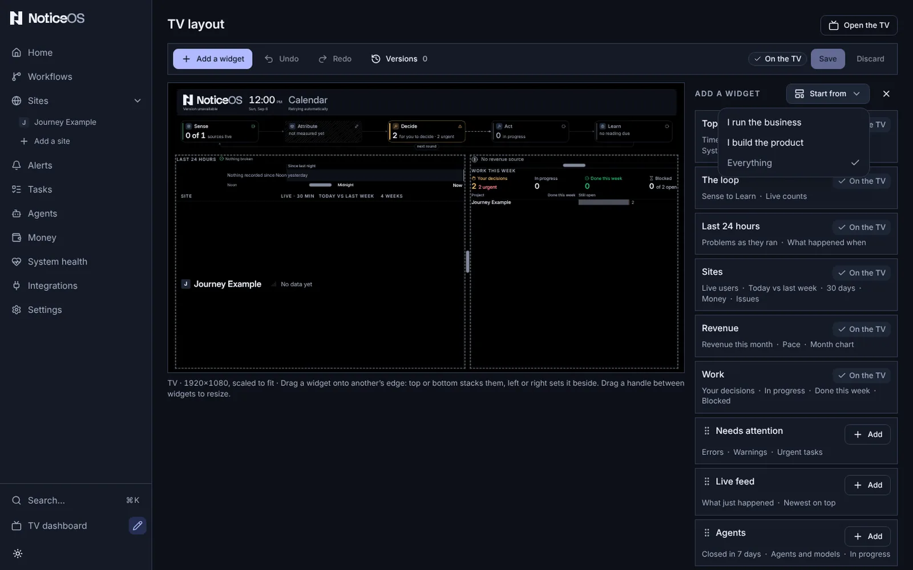

# Arrange the Wall

This page shows how to lay out the TV view the way you want it and save it as a version you can go back to.

The **Wall** is the Tower's TV view, at `/wall`: one screen of tiles, called widgets here, that shows how every site is doing to anyone across the room. See [The Wall](/tower/wall) for what each widget shows.

## Open the editor

The Wall itself has no controls. You arrange it from the Tower's ordinary pages with the sidebar.

1. In the sidebar, find the **TV dashboard** entry at the bottom. On a phone, open the menu first.
2. Select the pencil beside it, **Edit the TV layout**. The **TV layout** page opens with a copy of the TV screen in the middle, drawn by the same component the TV uses, and **Open the TV** in the header.

The editor also opens from **Settings** > **TV dashboard** > **Edit layout**, or from the command palette (⌘K) as **Edit the TV layout**.

### What is on the page

- **The bar above the TV**: **Add a widget**, **Undo**, **Redo**, **Versions**, then the layout's state (**On the TV** or **Unsaved changes**), **Version note**, **Save** and **Discard**.
- **The TV**, the whole 1920×1080 screen, scaled to fit your window. Point at a widget to see its toolbar: a grip, its name, **Move** and **Remove**. Select it to keep the toolbar and open its settings.
- **The side panel**: the selected widget's settings. With nothing selected, it lists the widgets on the TV to pick from. **Add a widget** and **Versions** open in the same place.
- **Site order**, under the side panel: **Move example.com up** or **down** sets the order the site rows are drawn in, everywhere. The link above the list, **Drag them, and choose where each shows, in Arrange**, opens **Arrange** on the Sites page, where the same order is set by dragging and each site has its switches for Home, the TV and Work this week ([Where each site shows](/tower/sites#where-each-site-shows)).

The widgets are a fixed library: **Top strip**, **The loop**, **Last 24 hours**, **Sites**, **Revenue**, **Work**, **Needs attention**, **Live feed**, **Agents**, **Site health**, **The agents** and **Visitors by channel**. The default layout places the first six. **Agents** ranks each agent and the model it named by tasks closed in the last 7 days, and shows how many tasks the agents hold now. **Site health** shows five dots per site for up, speed, errors, search and code; **The agents** shows what the agents are building, shipped this week and proved; **Visitors by channel** shows every site's visits by channel and the largest funnel drop. **Site health** and **Visitors by channel** can be narrowed to some sites. You cannot create a new widget, and a widget's settings are the only way to change what it shows. **Sites**, **Last 24 hours**, **Work** and **Needs attention** can each be narrowed to some sites. A site whose own **TV** switch is off is in no widget; its box in a widget's site list is empty, cannot be ticked, and reads **Off on the TV by its own setting**. On **Work**, a site whose **Work this week** switch is off reads **Off in Work this week by its own setting**. The countdown's dates are set on **Settings** > **TV dashboard** with **Set a countdown**, or in the **Top strip**'s settings.

## Start from a view's preset

Each of the three views has a ready-made layout:

| Start from | Layout |
|---|---|
| **I run the business** | **Top strip**, then **Site health** over **Revenue** on the left, beside **Needs attention** over **The agents** on the right |
| **I build the product** | **Top strip**, then **Revenue** over **Visitors by channel** on the left, beside **Sites** over **Work** on the right |
| **Everything** | the default layout |

1. Select **Add a widget**.
2. Select **Start from**, beside the drawer's title.
3. Select a view. The one already on the TV is ticked and cannot be selected.

The whole arrangement on the TV copy is replaced by the preset. It is not on the TV until you select **Save**, and **Undo** puts back the arrangement you had. A version saved this way with no note is named **Started from I run the business**, or the view you chose.

Until any layout is saved, the TV shows the preset of the workspace's default view (Settings > General > **Your view**), and the editor opens on it.

## Move a widget

Drag it by any part of it. As you drag, a line on the TV and a label beside it, such as **Above Sites**, show where it will go. They appear only where the widget can go:

| Drop it on another widget's | Label | What happens |
|---|---|---|
| top or bottom edge | **Above**, **Below** | the two stack in one column, the moved one above or below |
| left or right edge | **Left of**, **Right of** | it becomes a column of its own beside that widget's column, taking half its width |
| the band between two rows | **New row** | it gets a full-width row of its own there |

So to make two widgets share a column, drop one on the other's top or bottom edge. To take a widget out of a column, drop it on the left or right edge of any widget. When a column has only one widget left, the column is removed and the widget takes its place. An empty row is removed.

The moved widget is selected and briefly shows a coloured outline in its new place.

### Without dragging

Every widget has a **Move** menu, on its toolbar on the TV and in its settings in the side panel. It can move a widget to every place a drag can, for use with a keyboard, on a phone, or when you prefer to choose from a list:

- **Move up**, **Move down**: one place up or down its column, then out into a row of its own. If a widget is alone in its row, the whole row moves with it.
- **Move left**, **Move right**: into the neighbouring column, at the same height. Two single widgets side by side swap places.
- **Stack under…**: under any other widget you name.
- **Into its own column**, **Into a new row above**, **Into a new row below**.
- **Remove**.

A direction that would not move it is greyed out. With a widget focused, **Alt** and an arrow key do the first four. After each move, a status message for screen readers describes where the widget went, and focus stays on the widget.

## Resize

- **By dragging**: point at the gap between two columns, or between two widgets stacked in a column, and drag the handle. The size of each shows as you drag, and the handle snaps to a quarter, a third, a half, two thirds and three quarters. The handle stops before a neighbouring widget becomes too small to read. With the handle focused, the arrow keys move it a step and **Page Up** or **Page Down** jump to the next of those sizes.
- **In one press**: in the widget's settings, set **Width** (or **Column width** for a stacked widget) to **¼**, **⅓**, **½**, **⅔** or **¾** of its row. Set **Height** to **Fit content** or **Fill the rest**, or for a stacked widget to a third, a half or two thirds of its column.

With **Fit content** a widget is as tall as what it shows, and widgets side by side in one row are as tall as the tallest of them. **Revenue** draws its month chart behind its figures, so at **Fit content** it is as tall as its lines of text, and beside **Needs attention** it is as tall as Needs attention. **Work** at **Fit content** is as tall as its figures and one line per project. Given less height than that, Work shows the projects that fit and counts the rest, such as **+2 more projects**. To give the site rows the most room, set **Revenue** and **Work** to **Fit content** and **Sites** to **Fill the rest**.

A widget drawn smaller than it can be read shows **Too narrow for Sites** (or **Too short**) in place of its content. Make it bigger or move it, and the widget's content is shown again.

## Undo and save

- **Undo** and **Redo** (⌘Z and ⇧⌘Z, or Ctrl on Windows and Linux) step through every change since you opened the page, a whole resize drag as one step. **Discard** goes back to what is on the TV, and can itself be undone.
- In **Version note**, type a note if you want one. Leave it empty and the version is named by what changed, or **Started from \<view>** when the layout is a view's preset.
- Select **Save**. The bar shows **On the TV** again, and the TV redraws the next time it refreshes its data.

If you leave the page with unsaved changes, you are asked to confirm first.

### Versions

**Versions** in the bar lists every saved layout, newest first, each with **Revert**. Revert works like any other save: the layout it replaces is added to the history too, so nothing is lost. There is no confirmation step because you can always revert to an earlier version.

## Check the fit

The Wall has a fixed height and nobody at the TV can scroll, so check that the layout does not grow taller than the screen. The editor checks the TV as you work and shows a caution chip when a layout would not fit, such as **This layout runs 40 px past the TV.**

1. When the chip appears, make a widget's height **Fill the rest**, give a stacked widget a share of its column, narrow a widget, or remove one.
2. If you run NoticeOS from source, run `pnpm audit:wall-fit` after adding sites or widgets. It measures the live Wall at the TV's size and reports anything that does not fit, including text that overflows its box.

::: tip
On a landscape laptop the Wall shows the TV's layout scaled down; on a portrait tablet or a phone the widgets are stacked in one column. The editor sets the layout for the TV, and the other screens are derived from it. On a phone the copy of the TV screen is too small to drag on: select a widget and use its **Move** menu and sizes in the side panel.
:::

## Verify

- The bar shows **On the TV**, and the count beside **Versions** has gone up by one.
- No caution chip is shown, no widget shows **Too narrow** or **Too short**, and `pnpm audit:wall-fit` reports no overflow.
- The TV redraws with the new layout the next time it refreshes its data.

## If it didn't work

- No line appears where you drop: the widget cannot go there. A row holds at most four columns, a column six widgets and the TV six rows, and each widget appears once.
- A widget in **Add a widget** shows **On the TV**: it is already placed. **TV full** means there is nowhere left to put one.
- The chip shows that the layout runs past the TV: see [Check the fit](#check-the-fit).
- The TV still shows the old layout: it redraws the next time it refreshes its data, and keeps showing the old layout until then instead of going blank. See [Troubleshooting](/operate/troubleshooting).

The Wall's design is in [doc 14, Design](../14-design.md#the-wall). The fit check: https://github.com/notice-cx/NoticeOS/blob/main/scripts/README.md#auditwall-fit--does-the-wall-still-fit-the-tv.

## Next steps

- [TV dashboard](/tower/wall)
- [Settings](/tower/settings)
- [Home](/tower/home)
