## How NoticeOS works

Every reading is stored by asset and by day. A day a source has not reported stays unknown and is never counted as zero. [How NoticeOS works](/concepts/how-noticeos-thinks) describes the loop that uses these readings.
