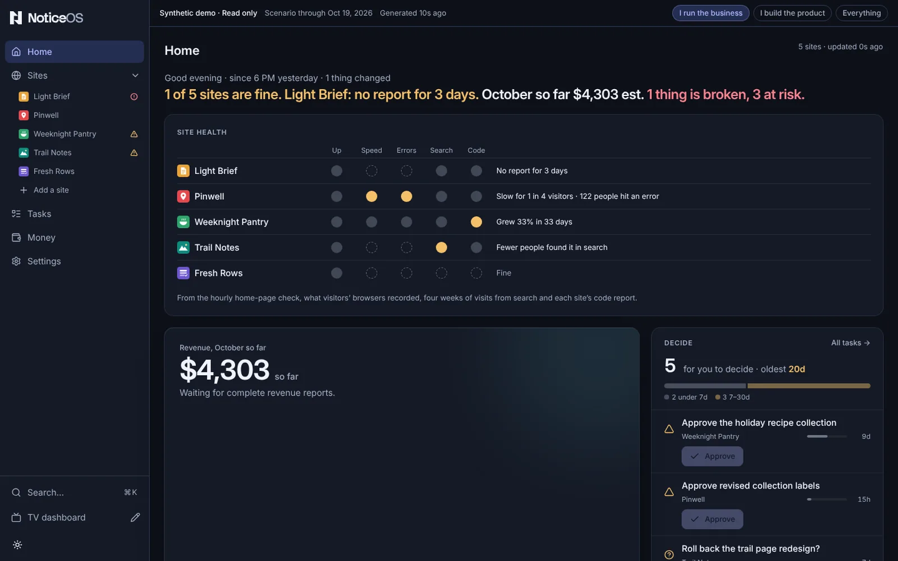

# Try the demo

This page describes what the demo shows and how to run your own copy of it.

## Before you begin

The demo is the real NoticeOS app with **synthetic data**. Five fictional assets, their traffic, search counts, revenue estimates, tasks and workflows are generated by a simulator that keeps running after setup. A banner on every page shows that the data is synthetic and when it was last generated.

Visitors can explore Portfolio, Money, Tasks, Workflows, Integrations, Settings and the Wall. They cannot change data, connect a provider or sign up. No analytics provider or calendar feed is called; every number is derived from the scenario. The demo is a public preview, not customer account hosting.

- **Integrations** shows Google (Analytics and Search Console), Bing and the ad network as connected through demo connections. A demo connection stores no login and fetches nothing; its syncs are the collection runs the simulator records, so a failed run shows that source failing until the next one succeeds.
- **Workflows** shows three workflows, each run once as the demo starts and then every hour, so their runs are there from the first minute.

The demo package runs the compiled app, Postgres and Dolt on a Linux server or VM, including a Proxmox VM, behind an HTTPS reverse proxy you provide. To run your own copy you need:

- Docker with Compose, and at least 8 GiB free **after** about 4 GiB for the first build.
- An exact 40-character source commit, built from the history-free public source export for that commit.
- A public HTTPS origin and a TLS reverse proxy on the same VM, or in a container sharing Dolt's network namespace. The proxy must pass the exact `Host` header and browser `Origin` through.

Only the app's HTTP port is published, on the host's loopback. Postgres has no host port.

## Switch the view

The banner at the top of every page, the TV dashboard included, holds three choices at its end: **I run the business**, **I build the product** and **Everything**. On a phone they sit on a line below the banner's text. Pressing one redraws the Tower in that view at once: the sidebar's pages, Home's sections and each asset's tabs.

The TV dashboard at `/wall` follows the same choice. **I run the business** and **I build the product** show that view's layout; **Everything** shows the demo's own layout. To open the TV dashboard in one view without pressing anything, add `?view=business`, `?view=product` or `?view=everything` to its address.

The choice is kept in the visitor's browser, so it stays after a reload and no other visitor sees it.



See [Choose your view](/guides/choose-your-view) for what each view changes.

## Configure

1. Copy `deploy/demo/example.json` and `deploy/demo/example.env` to a private folder outside the checkout, for example `/operator/`.
2. In the JSON, set the full source commit, an exact UTC cutoff (`YYYY-MM-DDTHH:mm:ss.sssZ`, not in the future) and a future `serviceExpiresAt` within 366 days. After this time the simulator is no longer allowed to update the demo; a restart does not extend it.
3. In the env file, set the exact image tag, the absolute config path and an unused loopback port. These examples use `demo-preview`, `/operator/demo.env` and port `16448`.
4. Choose a **new** Compose project name. Never reuse an existing installation's project or volumes.

## Build and start

1. In the checkout, build the image and check the Compose file:

   ```sh
   docker build --build-arg NOTICEOS_SOURCE_COMMIT=FULL_SOURCE_COMMIT -f deploy/demo/Dockerfile -t noticeos-demo:FULL_SOURCE_COMMIT .
   docker compose --env-file /operator/demo.env -p demo-preview -f deploy/demo/compose.yaml config --quiet
   ```

2. Prepare, start the stores, run setup, then start the app:

   ```sh
   docker compose --env-file /operator/demo.env -p demo-preview -f deploy/demo/compose.yaml run --rm --no-deps prepare
   docker compose --env-file /operator/demo.env -p demo-preview -f deploy/demo/compose.yaml up -d --wait postgres dolt
   docker compose --env-file /operator/demo.env -p demo-preview -f deploy/demo/compose.yaml run --rm setup
   docker compose --env-file /operator/demo.env -p demo-preview -f deploy/demo/compose.yaml up -d --wait app
   ```

Setup applies the schema to its new empty store, creates the demo workspace, seeds the scenario and writes private runtime configuration.

::: tip Counting visitors is optional
Set `NOTICEOS_DEMO_STATCOUNTER=project:security` in the private env file to add a Statcounter tag, then recreate the app. When it is unset, the pages include no analytics.
:::

## Stop, restart and update

1. To stop without deleting data, run:

   ```sh
   docker compose --env-file /operator/demo.env -p demo-preview -f deploy/demo/compose.yaml stop app dolt postgres
   ```

   Allow up to 90 seconds.

2. To restart, run the `up` commands from Build and start again, without running preparation or setup.
3. To update, keep a copy of `deploy/demo/update.sh` outside the checkout and run it on the demo host:

   ```sh
   /operator/update.sh --env /operator/demo.env --source /operator/src
   /operator/update.sh --env /operator/demo.env --source /operator/src --commit FULL_SOURCE_COMMIT
   ```

A compatible release changes only the image tag and recreates Dolt and the app. A release with a different scenario version or schema gets a **fresh generation**: a new project (`demo-g2`, `demo-g3`, …) with new volumes, seeded from scratch and started in place of the old one on the same port. The script takes no backup; take one first.

Each build adds an image of about 2 GB, and each stopped generation keeps its image and its four volumes, so the script removes what no deploy needs. After a healthy update it removes every stopped generation except the one that update replaced, then demo images no container uses, keeping the new release and the one it replaced, and unused build cache. Before building it needs 12 GiB free for Docker; with less, it removes those unused images and the build cache, then every stopped generation. If that is still not enough it stops before building, leaves the running demo unchanged and prints `docker system df`. It never removes the running generation.

## Back up a demo

1. Stop the app, Dolt and Postgres.
2. Back up all four named volumes together into a new private folder with mode `0700`. The exact `docker run` commands are in the demo guide on GitHub: https://github.com/notice-cx/NoticeOS/blob/main/deploy/demo/README.md.
3. Restore only into a **new project with four new empty volumes**, never over an existing store.

## Verify

1. On the demo host, run the health check:

   ```sh
   curl --fail --header 'Host: demo.example.com' http://127.0.0.1:16448/__noticeos_health
   ```

   A healthy demo returns `{ "ok": true }`.

2. Open the demo through your HTTPS proxy. Every page shows the synthetic-data banner with the time the data was last generated.

## If it didn't work

- Setup fails: keep the volumes for diagnosis; do not delete them to force a retry.
- A new generation fails its health check after an update: the script starts the previous generation again.
- The app rejects the hostname: the proxy must pass the exact `Host` header and browser `Origin` through. See [Troubleshooting](/operate/troubleshooting).

## Next steps

- [What is NoticeOS](/start/what-is-noticeos)
- [Install from source](/start/install-from-source)
- [Upgrade](/start/upgrade)
