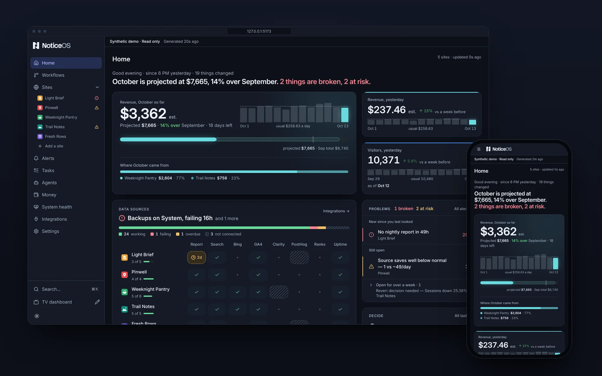
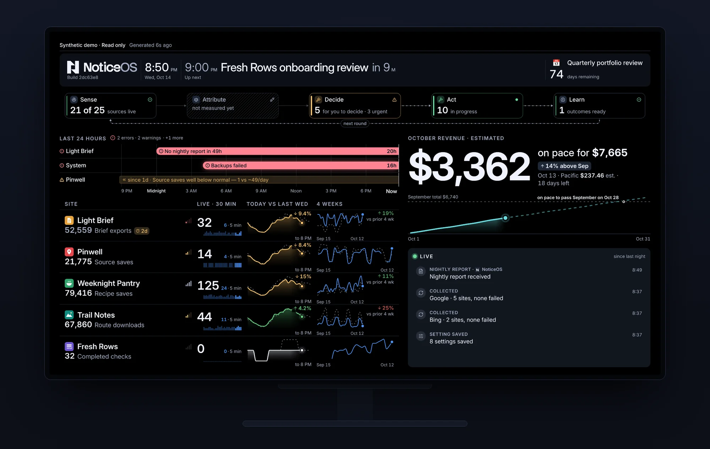

# What is NoticeOS

This page describes what NoticeOS does, who it is for, and what it does not do yet.

## One screen for your whole portfolio

NoticeOS is a self-hosted web app you run for your own websites and software products. You install it on your own machine or server, connect the services that already hold your data, and see everything in one place.

It shows four things:

- **What needs attention.** Collection failures, unusual traffic and missing evidence show up as alerts.
- **What makes money.** Recorded revenue and costs are shown side by side, with their dates and coverage kept visible.
- **What is in progress.** Tasks have owners, blockers, approvals and completion evidence across your projects.
- **What changed.** NoticeOS records the follow-up evidence for each shipped change, so you can check whether the outcome improved, not only whether the work is done.

## The Tower and the Wall

The **Tower** is the web app you work in, in your browser. Its pages with a sidebar are Home, Workflows, Portfolio, Alerts, Tasks, Money, System health, Integrations and Settings, and every asset you add gets a page of its own. [The Tower](/tower/) describes each one.

The **Wall** is a Tower view built for a TV or a second screen. It fits one 1920×1080 screen with nothing to scroll. Open it at `/wall` and lay it out at `/wall/edit`.

Both show the same data. You make changes on the Tower's pages; the Wall only displays data. Terms these docs use without explaining them are defined in the [Glossary](/concepts/glossary).

## Missing data is never shown as zero

NoticeOS never turns missing data into a zero.

When a collector fails, a provider is late, or a day is not yet final, the number stays **unknown** and the screen marks it as unknown. A chart stops at the last reported hour instead of drawing a flat line at zero. A revenue estimate is labelled an estimate until it is reconciled.

For you this means two things. A zero on a card is a real zero that a source reported. A gap on a card means the data is missing, not that the value fell. Open [System health](/tower/health) to see which collection is late and why.

## Who it is for

NoticeOS is for a founder or a small team running several websites or products who wants to see everything in one app instead of a tab per provider. You need to be comfortable with a terminal for installation and upkeep, and with a browser for everything else.

It is **not** a public hosted service. A standalone installation has no user login: anyone who can reach it can read and change its data. Keep it on a private network, behind a VPN, or behind an access proxy of your own.

## What you get today

- A **standalone installation**, with its own Postgres database and its own task database, set up with one Docker command or from source. See [Install with Docker](/start/install-with-docker) and [Install from source](/start/install-from-source).
- An **application container** for an installation you have already prepared. See [Run with Docker](/start/run-with-docker).
- A **public demo package** with synthetic assets and ongoing simulated activity, for a read-only preview on a Linux server. See [Try the demo](/start/try-the-demo).
- Provider credentials connected **in the product** on the Integrations page, encrypted in the store. See [Secrets and credentials](/operate/secrets-and-credentials).
- A **Tasks** page shared by people and agents, usable before you add your first asset.
- Five purpose **views** of the Tower: **Overview**, **Growth**, **Revenue**, **Delivery** and **Reliability**. The global view bar changes each page's emphasis and context while keeping navigation and asset tabs stable. The Wall uses a separate layout. See [Choose your view](/guides/choose-your-view).
- An **MCP server** at the Tower's `/api/mcp`, through which a coding agent on the same machine reads and updates your tasks and reads asset reports. See [Connect an agent](/guides/connect-an-agent).

## What is not available yet

- NoticeOS does not offer **customer account hosting** or invitation-based onboarding in this preview release.
- NoticeOS does not have installable agent skills and hooks, or connections to tools such as Jira or Linear, yet. Agents use the MCP server; people use the Tasks page.
- NoticeOS does not run **automated execution on your assets**. Agents that act on your assets are started and stopped by you, outside NoticeOS. See [Budgets and the kill switch](/operate/budgets-and-the-kill-switch).

## Where to go next

The first useful view is an asset's Overview after one data source is connected. [Install in five minutes](/start/quickstart) has the steps to get there; [Install with Docker](/start/install-with-docker) describes what its one command creates.

For the design behind all of this, read the architecture note in [doc 01, Architecture](../01-architecture.md).
