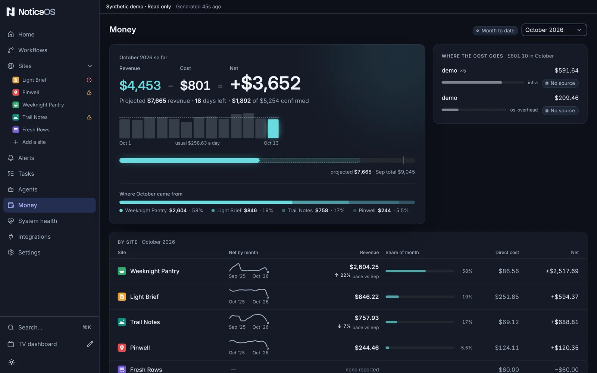

# Money

The Money page shows this month's net, and where the money comes from and goes. The sidebar calls it **Money**; its address is `/financials`.

## What you see

The page starts with the month as one equation: **Revenue − Cost = Net**, with the net as the largest figure. Under it, **Projected** the month's projected revenue and the days left while the month is open, and how much of the month is **confirmed**: backed by a reconciled payment or receipt, the rest estimated. A **Month to date** chip marks an open month. **Accounting period** picks another month.

Beside the equation:

- **The month's days** as bars, the newest in the revenue colour, with the usual day as a dashed line. A day no source reported is hatched, never a zero. A source that missed days is named under the bars with its count, such as **Northwind 20/21 days**.
- **The month against last month**: the month's revenue as a filled bar on a track that ends at last month's whole total, with an open month's projected total as a dashed line past the fill.
- **Where the month came from**: one bar split by the sites with revenue, each with its amount and share.

Then:

- **Where the cost goes** — each cost line, largest first: what it is, its amount, its share of the month's cost, its family, and where the figure comes from (**Subscription**, **Usage**, **Prepaid yearly**, **No source**).
- **By site** — every site ranked by revenue: **Revenue** with its change, **Share of month**, **Direct cost**, **Net**, and a small month-by-month net line. A closed month's change is against the month before; an open month's is the site's projected total against last month (**pace vs Aug**), not coloured green or red because it is an estimate. **Overhead**, the shared cost booked to the **System**, is its own row, and **Total net** is the sites' nets less that overhead. On a narrow screen each row shows the site, its revenue and its net; the other columns are hidden before a name is cut short.
- **Month by month** — revenue, cost and net for every month to the shown one, the open month marked.

Three panels open one at a time underneath:

- **Day by day** — the month's daily revenue to inspect, with partial days outlined and each source's reported days.
- **Every month** — **Revenue**, **Cost**, **Net**, **Reconciled** and **Net to date** for every month.
- **Declared costs** — **Recurring costs** and **Domain orders**, the two tables you edit. Over them, **Declared, by site** shows each site's declared run rate per month.

Revenue is collected (Mediavine, daily) and stays an estimate until reconciled. Costs are the rows you declare plus metered spend the product records itself, such as DataForSEO reports. A booked month is never rewritten; a correction is a new row.

## What you can do

- **Accounting period** changes the month shown.
- A site's name opens that site's own money.
- **Add** and **Remove** act on whole rows in **Recurring costs** and **Domain orders**; every cell is saved on its own, with **Undo** beside it.
- **Connect a revenue source →**, before any money is recorded, opens Integrations.

## States and labels

- **Month to date** marks an open month.
- **Nothing recorded for** appears for a month the ledger does not hold, with a list of the months it holds.
- **No money recorded yet** before any money is recorded.
- **Cost — none recorded** means no cost line exists for the month; it is not a zero cost, and the net then shows **revenue only**.
- **none confirmed yet** means nothing in the month has been matched to a receipt.
- **none reported** on a site row means no revenue arrived for that site this month; it is not $0.
- **Reconciled —** in **Every month** means nothing in that month has been matched to a receipt yet.
- A **No trend** dash on a site row shows why the month-by-month line cannot be drawn, usually because the site has fewer than three months.
- **Unavailable** means the month mixes currencies, so no single total exists.
- A declared cost that has not been booked into the month yet shows in **Declared, by site** but not in **Direct cost**; the two differ until the month's cost import runs.

## Related guides

- [Record revenue and costs](/guides/record-revenue-and-costs)
- [Connect data sources](/guides/connect-data-sources)
- [How NoticeOS works](/concepts/how-noticeos-thinks)
- The ledger's rules in [doc 02, Signal contract](../02-signal-contract.md#revenue--cost-the-ledger-feeds--required); recurring costs and domain orders: https://github.com/notice-cx/NoticeOS/blob/main/config/recurring-costs.README.md, https://github.com/notice-cx/NoticeOS/blob/main/config/domain-costs.README.md
