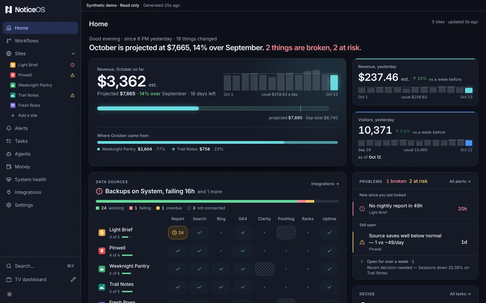

# Home

**Home** is the page the Tower opens on: one page that sums up every site, so you can tell in a minute whether anything needs your attention. New to the Tower? Start with [The Tower](/tower/).

Home shows three things, in this order: how the business is doing, what is broken, and what needs your attention. Which parts of Home show them depends on your view; see [Your view](#your-view).

## What you see

**The summary.** A small grey line shows the greeting, the window since 6 PM yesterday and how many things changed in it. Under it, one sentence sums up the page, such as **October is projected at $1,020, 9% under September. 2 things are broken.**

In the **I run the business** view, the sentence starts with the sites' health once at least one site is measured: **All 3 sites are fine.**, or **2 of 3 sites are fine.** followed by the site that most needs a look and its first problem, such as **Example Shop: the home page did not load.** That part is red when a site is down and amber when a site is worth a look. The month's money follows, and the count of broken things is shown only when there is at least one.

**Money.** The month so far is the largest number on the screen, marked **est.** while it is an estimate (**so far** in the **I run the business** view). Beside it, the month's days as bars, with a dashed line across them at the usual day. Under it, a bar shows the month so far, its projected total and last month's total, and **Where October came from** splits the month by site. Two figures are beside it: **Revenue, yesterday** and **Visitors, yesterday**, each with its change against the same day a week before and its recent days as bars. With no revenue source on any site, visitors come first and no money figure is drawn.

**Data sources.** One grid of every listed site and every data source, with a **System** row for the reports, scheduled runs, backups and data spend that keep NoticeOS running. A working source is a faint green tick; a failing one is solid red with how long it has been failing, and one failing for over a week has only a red outline, so new breakage stands out. Hatching means not connected. The **Backups** cell shows the age of the newest completed backup, such as **last good copy 12d ago**, or **no good copy yet**; it turns amber after one scheduled backup fails and red after two, dated from the first failure. From the second failure it also counts as one broken thing in the summary, until a backup completes. The newest problem is named at the top of the grid.

**Problems.** The open problems the grid does not already show, ranked: what started since you last looked first, then what is still open, and anything open for over a week collapsed into one line. An alert that has a usual range shows the reading against it.

**Decide.** How many decisions are waiting for you, how old the oldest is, and how the waiting decisions split by age. Then the first four, each with its age drawn as a length and its buttons: **Approve** for an approval, **Answer** or **Close as** for a question. **Show N more** opens the rest in place; **All tasks →** opens the board.

**Sites.** One row per listed site, in your order (set with **Arrange** on the Sites page): its status, people a day as a line with the latest day's count, yesterday's revenue with its change, and its share of the month. With one site, Home shows that site's own numbers and chart instead.

**The last 24 hours.** One row per listed site and one for the System, on a time axis that ends at **Now**. Open problems are bars from when they started; a problem older than the day starts at the left edge with its age written on it. Shipped changes, wins and recoveries are marks on their site's row. The shaded part is the time since 6 PM yesterday.

**Site health.** One row per listed site, with five dots under **Up**, **Speed**, **Errors**, **Search** and **Code**, and the row's problems in words beside it, such as **The home page did not load · Slow for some visitors**, or **Fine**, or **Still setting up · nothing measured yet**. A site whose nightly report is late shows **No report for 2 days** (or the hours, under two days) first, and is never **Fine**. On a phone the site's name takes its own line and the five dots share the width under the header. A dot is red when the site is down, amber when the fact is worth a look, grey when it is fine, and an empty dashed ring when it is not measured yet. The line under the grid names where the dots come from: the hourly home-page check, what visitors' browsers recorded, four weeks of visits from search and each site's code report. Each fact is described under [the site's **Health** tab](/tower/sites#the-health-tab).

**The agents · this week.** Three figures joined by **›**: **Building** (tasks in progress across the sites with a task project), **Finished** (tasks done so far this week) and **Proven to work** (sites whose newest measured change worked). **N being watched** beside the title counts the changes still being measured. Under the figures, up to three of the newest lines: a finished task with what it did, or a site's **Latest bet** with its result.

**Where visitors come from · 4 weeks.** Every listed site's visits by channel, added up by channel name, largest first, each as a bar and its percent of all visits; channels after the first five are added into **Other**. Beside it (under it on a phone), the funnel that loses the most people at one step, across the listed sites: the site and funnel name, every step as a bar with the step after the largest loss in amber, and a sentence naming the two steps, such as **120 people left between “Opened a recipe” and “Saved it”.** The part is as tall as its content.

**Worth a look.** Up to eight things the sites are missing, in this order: a site that earns nothing (**Example Shop earns nothing**), a site with no data feeds, a site with no task project, a site that sends no code report, then the opportunities the newest readings found, each with its site's name under it. Retired sites are left out, and a site not launched yet is not listed as earning nothing.

**Listed sites.** A site is listed while its **Home and Sites list** switch is on. A site with the switch off has no row in the grid, the sites or the last 24 hours; its problems are still counted in the summary and listed under **Problems**, and its money and visitors are still in the month's figures. A retired site has the switch off until you turn it on. See [Where each site shows](/tower/sites#where-each-site-shows).

**Until the first site has its first number**, Home shows one sentence and three steps: **Add your first site**, **Connect a source** and **See your first number**. The current step is shown as a button, and each finished step is marked done. Home also shows **Use \<zone>**, which saves your device's time zone in one press.

Above the steps, until you have chosen a view of your own, Home shows two questions in one box:

- **Which describes you?** lists the three views, **I run the business**, **I build the product** and **Everything**, each with one line under it. One press chooses the view and saves it.
- **What matters most?** then replaces it in the same box, with five picks: **Money**, **Visitors**, **Site health**, **The agents' work** and **Costs**. Any number can be picked; **Continue** saves them in the order picked and **Skip** saves none. Choosing **Everything** closes the box without this question.

The steps work before the questions are answered: a site can be added first, and until you answer, the pages use the workspace default view. The first answer on a new installation also becomes the workspace default, the view new people and the TV start from, when none is saved yet and settings can be saved.

## Your view

The view chosen on the first run, or later in [Settings → General → **Your view**](/tower/settings#general), decides which parts of Home are shown and in what order. The one-sentence summary at the top is shown in every view.

| View | Parts of Home, in order |
|---|---|
| **I run the business** | **Site health**, **Money**, **The agents · this week**, **Decide** |
| **I build the product** | **Money**, **Where visitors come from · 4 weeks**, **Worth a look**, **Problems**, **Decide**, **Sites** |
| **Everything** | **Money**, **Revenue, yesterday** and **Visitors, yesterday**, **Data sources**, **Problems**, **Decide**, the agents' line (**Agents closed N tasks in 7 days**), **Sites**, **The last 24 hours** |

In **I run the business**, Home opens on **Site health**, with the month's money and **Decide** under it and **The agents · this week** further down:

In **I build the product**, Home opens on the month's money beside **Worth a look**, then **Where visitors come from · 4 weeks** beside **Problems**, with **Decide** and **Sites** further down:

Each pick from **What matters most?** moves one part to the top, in the order picked: **Money** and **Costs** move **Money**, **Visitors** moves **Sites**, **Site health** moves **Site health** and **The agents' work** moves **The agents · this week**. A pick whose part the view does not show changes nothing: in the **Everything** view only **Money**, **Costs** and **Visitors** move a part. A part a view leaves out is still in the product: its page is in the sidebar of the **Everything** view and in Search (**⌘K**).

## What you can do

- Open a site from its row in the grid, the sites list or the timeline.
- Open a problem from its row in **Problems**; **All alerts →** opens Alerts.
- **Approve**, **Answer** or **Close as** a decision from its row; **Close as** declines it as **Won't do**, **Duplicate**, **Can't reproduce** or **Already handled**.
- Open Money from **Revenue, yesterday**, and the Sites page from **Visitors, yesterday** or **All sites →**.
- **Integrations →** opens the data sources' connections.
- In **Site health**, open a site from its name; point at or focus a dot to show its word and its problem. The site's **Health** tab shows the readings behind each dot.
- In **The agents · this week**, **Agents →** opens the Agents page.
- In **Worth a look**, **Make a task** on a row opens the task form with the row's title filled in and the site's task project chosen when it has one.
- On the first run, press a view under **Which describes you?**, then pick under **What matters most?** and press **Continue** or **Skip**.
- **Add your first site**, on the first run, opens the **Add a site** dialog.
- **Use \<zone>** saves your device's time zone for every daily figure.

## States and labels

- A site's status is one of **Setting up**, **On track**, **Monitor only**, **At risk**, **Off track** and **Retired**. Only **At risk** and **Off track** are coloured. A retired site's problems are not counted or listed on Home; they stay on Alerts.
- **est.** marks revenue as an estimate until it is reconciled.
- A missing figure is shown as a label, never drawn as zero: **not reported yet**, **no revenue**, **no visitors reported**.
- **Nothing is broken.** means there is no open problem anywhere. Monitoring is still running.
- In **Site health**, a fact is red only when the site is **Down**. Amber words are **Not checked lately**, **Slow**, **Some** (errors), **Falling**, **Sitemap failing** and **Growing fast**. A fine fact is grey: **Up**, **Fast**, **OK**, **None**, **Few**, **Steady** or **Growing**. A dashed ring is **not measured yet**, **too few visits yet** or **too early to tell**. A retired site and one not launched yet have every fact **not measured yet**.
- In **The agents · this week**, a figure that cannot be counted shows **not counted yet**: **Building** until a site has a task project, **Finished** while any task project cannot report its week. A **Latest bet** reads **Worked**, **Did not help**, **Changed nothing** or **Could not be measured** once measured, and **We'll know in N days**, **We'll know soon** or **Still being watched** before.
- **Where visitors come from · 4 weeks** shows **Not joined yet** while no site sends visits by channel. Its funnel side shows **No funnel declared yet** when product analytics is read but no funnel is declared, and **Not joined yet** when no product analytics is read.
- **Worth a look** shows **Nothing is missing.** when it has no rows.
- Home's layout depends on its width: one column on a phone or a narrow window, two on a portrait monitor, the full layout on a wide screen.

## Related guides

- [Install in five minutes](/start/quickstart)
- [Add your first site](/guides/add-your-first-site)
- [Tasks](/tower/tasks) and [Sites](/tower/sites)
- The design in [doc 14, Design](../14-design.md#surfaces-as-built)
