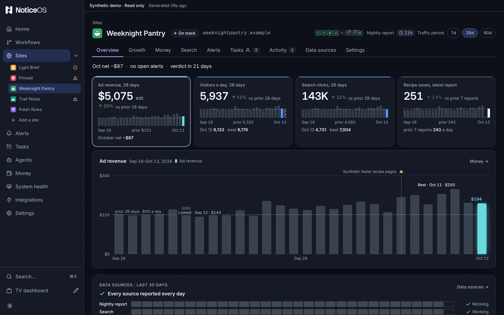

# Sites

A **site** is one website or product you added to NoticeOS. The **Sites** page compares them all side by side, and each site's name opens its own page, which shows everything about that one site.

The Sites page shows which sites need your attention.

## What you see

**The Sites page** starts with a one-line summary: **2 of 6 sites need attention**, with their names, or the count of sites that are fine, beside the month's pace and yesterday's visitors against the same day a week before. **Add a site** is in the header. Under the summary, one bar splits the sites by status, worst first: **Off track** in red, **At risk** in amber, the other statuses in grey. Then the sites compared, one row per site:

| Column | What it holds |
|---|---|
| **Site** | its name, and under it its status: **Setting up**, **On track**, **Monitor only**, **At risk**, **Off track**, coloured only when it is a problem |
| **People a day** | the last four weeks as a line, and the latest finished day's count |
| **Yesterday** | yesterday's revenue and its change on the same day a week before |
| **Share of month** | the site's part of the month's revenue so far |
| **Sources** | one mark per data source, coloured by its state, and how many are live of the ones the site uses |

A site's tasks, search clicks and ledger are on its own tabs. Columns are hidden as the window narrows, the name last: on a phone each row shows the site, its status and yesterday's revenue.

The page lists the sites whose **Home and Sites list** switch is on. The summary, the status bar and the stage counts count only those; the month's pace and yesterday's visitors stay the whole portfolio's. When a site is left out, the line above the rows counts it: **6 sites · 2 hidden**.

**A site's page** has a header with the site's name, its domain as a link, and its status, which on hover shows how many alerts are open. Under the header are the tabs: **Overview**, **Growth**, **Money**, **Search**, **Codebase**, **Alerts**, **Tasks**, **Activity**, **Data sources** and **Settings**. The tab is in the address, so a link opens the right one.

**Overview** shows the most important figures on the first screen. A row of figures for money, people, search and the site's one product figure, each with its window, its change against the days before, its recent days as bars with their dates, and one line of context. Press a figure to draw it on the chart: bars with a dashed line at the level of the days before, the best and lowest day labelled, every shipped change a labelled mark, and shaded spans for an open alert (with the rule's normal range), an outcome check or days not reported. Then **Data sources · last 30 days**, one row per source and one square per day, with the source that failed most recently or missed the most days first, and **Open alerts** for anything the chart does not already show. Under them: **Needs attention**, **What matters**, **Bets** (the site's outcome checks, open ones first with the days left to their verdict), **Search movers**, **Product use** and the site's totals. A provider's name appears only as a chart key beside its own line.

**The other tabs:**

- **Growth**: what changed against the days before, one row per series, above the **Audience** and search charts; then the tracked search terms and product use.
- **Money**: the month as one sum, revenue minus cost equals net. Beside it, the month's daily ad revenue against a usual day and the month so far against last month, both marked as estimates. Then daily revenue over the chosen range and the site's ledger, as on the Money page.
- **Search**: **Queries that moved**, each drawn at its position on the results page now and before; the tracked terms, each with its rank over time; then **Search context**: links, AI mentions, competitors and opportunities.
- **Codebase**: one sentence on how the code changed in 30 days, beside the site's visitors; five figures, **Lines of code**, **Repeated code**, **Unused code**, **Hard-to-change functions** and **Test coverage by size**, each with its change and its last 90 days; lines of code over time with deploys marked; the languages; and the findings, **Repeated blocks**, **Hard-to-change functions** and **Unused**, each row with **Make a task**. Before the first report it lists the ways to send one. See [Measure your codebase](/guides/measure-your-codebase).
- **Alerts**: the last 30 days as a timeline, one row per condition, then **Open** with each reading against its normal range, **Snoozed**, **No longer current** and **History**.
- **Tasks**: the site's slice of the Tasks board.
- **Activity**: the last 90 days of changes and bets on one timeline, a bet marked where it was registered and again where its verdict was recorded. Under it, the **Timeline** of recorded changes and the bets still being measured.
- **Data sources**: how the site's data arrives, drawn as one diagram with a failing source outlined in red; then one row per source with **Connect**, **Not using** and the mapping fields, and **More sources** for the optional ones.
- **Settings**: one column of cards: **Identity**, **Manual lifecycle stage**, **Where it shows**, **Automation**, **Data collection**, **Card totals**, **Alert rules in force**, **Tracked search terms** and **Archive**. **Where it shows** holds the site's place in your order, such as **3rd of 8**, with **Move up** and **Move down**, its three switches, and **Arrange the sites**, which opens Arrange.

## What you can do

- **Add a site** opens the same dialog Home uses.
- The legend of the bar that splits the sites by status is the **Health** filter: press **2 at risk** to show only those sites, press it again to show them all.
- **Order** puts the sites in **Your order** (the saved order Home and the TV use), **Needs attention** first, by **Money** this month, by **People** or **A–Z**. The stage list narrows to one lifecycle stage. On a phone both are behind **Order & stage**.
- **Arrange**, beside the stage list, lists every site in **Your order**, hidden ones included. Drag a site by its grip to a new place: a line and a label such as **Above Northwind** show where it lands before you let go. **Move Northwind up** and **Move Northwind down** on each row make the same move with a keyboard or on a phone. Each row has the site's three switches, **Home and Sites list**, **TV** and **Work this week**. A move and a switch save at once, each with **Undo** in its message: **Site order saved**, **Saved — Northwind hidden on the TV**. **Done** returns to the list in the order you chose, with the hidden sites left out and counted. **2 hidden** beside the count also opens Arrange, and so does **Arrange the sites** in the command palette.
- A filtered list shows how many sites it includes, with **Clear**. Every choice is in the address, so a link includes it.
- A site's name opens its page; the domain link on that page opens the site itself.
- Press a figure on the Overview to draw it on the chart; arrow keys step through its days.
- Hover, focus or tap a mark on the Overview chart to read the change or outcome check behind it.
- On **Activity**, **Log a change** opens one form with two choices: **Something happened** records a change, and **Watch an outcome** registers an outcome check against one.
- On **Data sources**, **Connect** opens the connect panel and **Not using** records a reason for skipping a source.
- On **Settings**, the cards hold everything that applies to this one site.

## Where each site shows

Each site has three switches:

| Switch | When it is on, the site shows |
|---|---|
| **Home and Sites list** | as a row on Home (the data sources grid, the sites and the last 24 hours) and on the Sites page |
| **TV** | in every widget on the TV |
| **Work this week** | as a project row in the TV's **Work this week**, while its **TV** switch is on too |

The switches are on every row of **Arrange** on the Sites page, on the **Sites** card of **Settings** > **TV dashboard**, and on the site's own **Where it shows** card. A switch with a tick is on; one with a crossed-out eye is off.

A switch nobody has set follows the site's lifecycle stage: on for every stage except **Retired**, and off for a retired site. A switch you set stays as you set it when the site's stage changes, so a site you take off the TV stays off after you restore it.

A site whose switches are off still collects data, raises alerts and files tasks. Its problems are still counted on Home and listed under **Problems** and on Alerts, its tasks stay on the Tasks board, and its money and visitors stay in the month's figures. **Revenue this month** on the TV counts every site's money.

The switches are stored in `config/tower.json` at `sites`, by site id, and are exported with the rest of the configuration.

## States and labels

- A site that reported nothing shows a label in its row: **no visitors reported**, **no revenue**, never a zero.
- With no sites the page shows **No sites yet**; with one, it is that site's row.
- **2 hidden** beside the count is how many sites have their **Home and Sites list** switch off. **Every site is hidden** means every site's switch is off.
- A site with no numbers yet opens on **Data sources** instead of an empty Overview.
- A **hollow point** is a day still being counted; it fills in once the day is complete.
- A **dashed line** is a projection or last week's comparison, never a measurement.
- A **bracketed day** on the axis is a day that cannot be compared with others, such as a day a reporting time zone changed; it is not coloured as better or worse.
- A **dash** in a figure marks a missing value. Hover over it for the reason.
- **unknown** means there is not enough data for a figure. A measured zero is different: it is drawn as zero.

## Related guides

- [Add your first site](/guides/add-your-first-site)
- [Connect data sources](/guides/connect-data-sources)
- [Attribution and measurement](/concepts/attribution-and-measurement)
- The design in [doc 14, Design](../14-design.md#surfaces-as-built)
