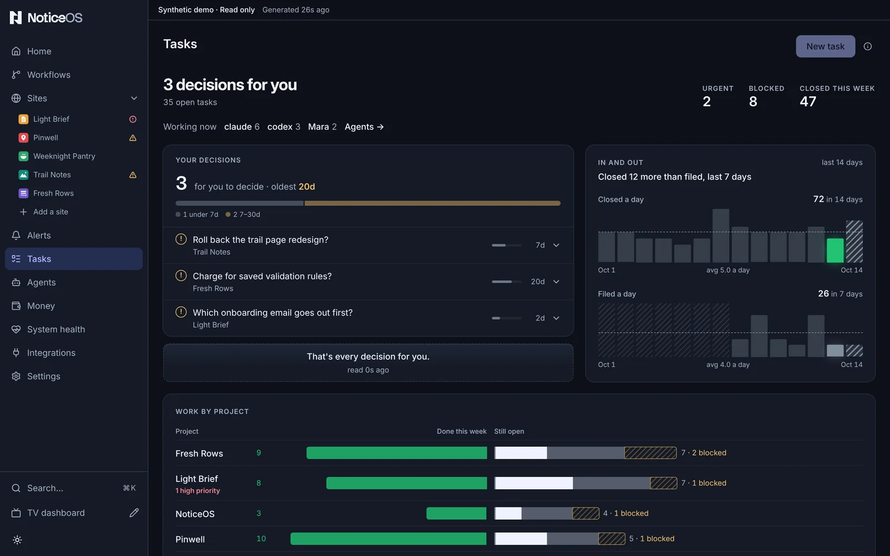
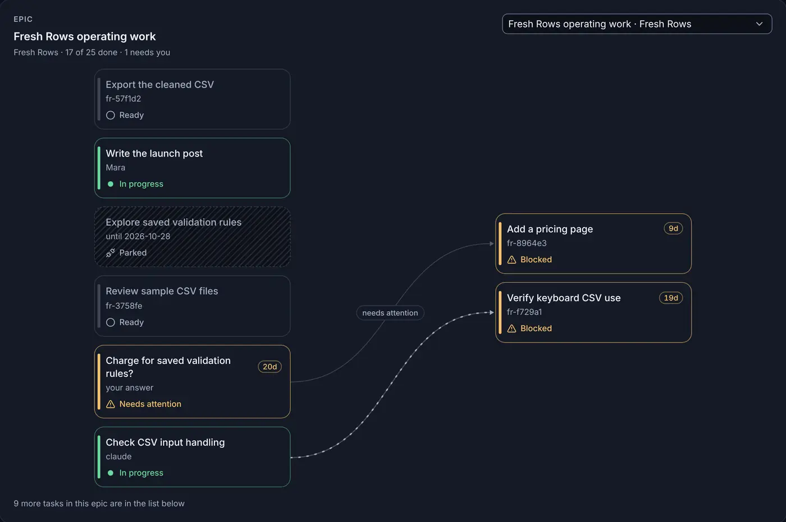

# Tasks

A **task** is one piece of work, for a site or for the **System** (this installation's own NoticeOS), with its status, owner, blockers and the evidence it was closed with. People and AI agents share the same tasks, each site in its own project. The **Tasks** page shows every project at once. How tasks connect to changes and outcomes is in [Tasks and agents](/concepts/tasks-and-agents).

The Tasks page shows how big the queue is, and which tasks in it cannot move forward without you.

## What you see

The page starts with a one-line summary: **No decisions for you**, or **3 decisions for you** with **1 needs your approval** and how many tasks are open under it. Three figures follow: **Urgent**, **Blocked** and **Closed this week**.

**Your decisions** is the queue: how many decisions are waiting, the oldest one's age, and one bar splitting them by age (under 7 days, 7–30, 30–60, over 60). Each decision is a row with its age drawn as a length and its buttons: **Approve** for a gate that blocks work until you approve it, **Answer** or **Dismiss** for a question. A row's caption names the project and, for a gate, **needs your approval**. Pressing the row opens its details in place. The queue ends with **That's every decision for you.**

**In and out** draws the last 14 days: tasks closed a day and tasks filed a day, each with a dashed line at its daily average, and one line stating whether more tasks were closed or filed over the days both were counted. Today is drawn hatched while it is still being counted.

**Work by project**, when the board shows more than one project, compares each project's week: done this week extending left, still open extending right, split into in progress, ready to start and blocked, with each project's high-priority count under its name.

**Epic** draws one epic's tasks as a graph: each task in its state (**Done**, **In progress**, **Ready**, **Waiting**, **Blocked**, **Needs attention**, **Parked**) and an arrow from each task to the task it blocks. An arrow from a blocked or parked task is drawn broken; an arrow from a decision of yours is labelled **needs attention**. The epic with the most blocked or parked tasks that block other tasks is shown first.

**Filters**: **Project** (**Every project** or one), **Status** (**Any status**, then **Open**, **In progress**, **Blocked**, **Parked**, **Closed this week**, each with its count), **Priority**, **Assignee** and a label. The filters narrow the list, not the charts above it.

**Working now**, under the summary, lists who holds tasks in progress and how many each holds, with a link, **Agents →**, to the [Agents](/tower/agents) page.

**All tasks** is the table: **Id**, **Project**, **Who** (the agent or person holding it, or **nobody**), **Age** and **State**. Each row opens its task page at `/tasks/<id>`, with the full description and the evidence attached when it was closed.

A task's page starts with where the task sits: **Tasks**, its project and its epic, each a link. **Tasks** keeps the filters the board had when the task was opened; a page opened from Home or a site also shows **Back to Home** or **Back to site**. Over the title are the type (**Task**, **Bug**, **Feature**, **Chore**, **Epic**, **Decision**, or **Approval** for a task that waits on your approval) and the id. Under the title are the state, the priority, who holds the task with the model they named and how long ago they claimed it, an epic's progress, and, for a decision of yours, **Needs your approval** or **Needs your answer**. The actions sit beside the title, the next one first: **Approve**, or **Answer** and **Dismiss**, for a decision; **Claim** while nobody holds the task; **Close** once somebody does. A closed task shows **Close reason** directly under the header: who closed it, the model they named, how long ago, and the reason they gave. On a laptop the description, **Done when**, the tasks it waits on, an epic's tasks and **Activity** fill the left column, and the facts fill the right: **Project**, **Parent epic**, **Status**, **Priority**, **Assignee**, **Labels**, **Parked until**, **Came from** and **Ages**. On a phone the facts wrap as one row of chips under the header.

A description written in the task guide's labels (`WHAT:`, `WHY:`, `WHERE:`, `FIX:`, `ORDER:`, `CONSTRAINT:` and a `## Steps to Reproduce` heading) shows each label over its text; a description without them shows as written. File paths show as code chips, and a task id of a known project links to its page. **Done when** shows each line that starts with a dash with a box beside it.

When the task waits on other tasks, or other tasks wait on it, a graph shows them: **Blocked by** on the left, **This task** in the middle and **Blocks** on the right, each card in its task's state with an arrow along each link. An arrow from a blocked or parked task is drawn broken, and one from a task in progress moves. Each card opens its task's page.

**Activity** draws when the task was filed, claimed, commented on and closed on a time axis that ends at **Now**, then lists the same moments in time order: who did each, with the model they named and their agent's mark, each comment's text, and a close's reason with its commits as chips. The comment box is the last item.

An epic's page lists the epic's tasks under **Tasks**, grouped by the states the **Epic** graph draws (**Needs attention**, **In progress**, **Ready**, **Waiting**, **Not started**, **Blocked**, **Parked**, **Done**) and sorted by priority inside each group. Each row shows the task's state mark, id, title, who holds it with the model they named, and its priority mark, and opens the task's page. The header shows a bar with one segment per task, and **2 of 7 closed**: the epic's closed tasks against all its tasks. Closed tasks are filled, a task in progress is half filled, a blocked task is in the warning colour, and a task the page cannot place is hatched. The list holds the tasks closed in the last 7 days; a line under it, such as **3 more, closed over 7 days ago**, counts the older ones. **Epic graph →** opens this page's epic in the **Epic** graph, and appears only when the board draws a graph for it. A task in an epic shows the same bar under **Parent epic**, with this task ringed and the first task in the epic that can be claimed now marked with a dot; **Next ready:**, after the same dot, names that task.

The board works on a new installation because it ships with the **System** project.

## What you can do

- **Approve** a gate from its row.
- **Answer** a question: the box opens on the row, you type **Your answer** and select **Send**. The answer text becomes the note.
- **Dismiss** a question you decline.
- Decide several at once: **Select** beside **Your decisions** puts a checkbox on every row you can answer and shows every row. Tick rows, or **Select all**, then **Approve** sends every selected gate and **Answer** or **Dismiss** every selected question; each button shows how many rows it sends. One **Undo** takes the whole batch back. After the Undo window the rows are sent one at a time, and any that are refused are named in a message and return to the queue. **Done** leaves without sending.
- Select a project's name in **Work by project** to narrow the list to it.
- Pick another epic from the list beside **Epic**; the choice is kept in the page's address. Select a task in the graph to open its page.
- On a task's page, **Claim** assigns the task to you. **Close** opens **What shipped, and the commit**; **Close task** closes the task with what you type there. When an action cannot run, the reason is written under it, such as **Unavailable in this workspace.** **Edit** beside **Description** or **Done when** edits it in place, and **Comment** adds what you type in the comment box.
- Each fact on the right is drawn as its value. Pressing **Status**, **Priority**, **Assignee** or the arrow beside **Parent epic** opens its choices; **Assignee** also takes a typed name under **Someone else**, and **Parent epic** a task id under **Another task id**. **Parked until** offers **Tomorrow**, **In a week**, **In a month**, a date, and **Not parked** while the task is parked. The dashed **Label** chip takes a new label, and the **×** on a label removes it. A choice or Enter saves at once, and the message that follows carries **Undo**; Escape closes the choices without a change. Where the task cannot be edited, the facts show their values and nothing opens.
- **New task** opens the composer in place. It has fields for a **Title** (**What should be true when this is done**), a **Project**, a **Priority** and a **Type**, with optional **Parent epic**, **Labels**, a **Description** (**What, why with the numbers, where**) and **Done when** (**The proof that it is done**). **File task** files it.
- **File task** on a finding, from a site's Overview, opens the same composer prefilled from the finding; the finding then shows a link to the filed task.
- **Add a task project**, on a site's Tasks tab, opens **Settings** > **Task projects**.

## States and labels

- A figure shown as **—** means the board could not read that project; it is never a zero. The summary line then shows **Couldn't read your decisions**.
- A count shown as **12+** is a lower bound: the snapshot holds only the first items of each list.
- On a hosted view the board shows a **Read-only snapshot** banner: the rows are the last snapshot and the actions are off. **Filed a day** then shows **not in the saved snapshot**, and no epic graph is drawn, because the snapshot holds neither filing dates nor dependencies. An epic's page there lists the epic's tasks the snapshot holds and counts the others, such as **4 tasks not in the saved snapshot**.
- A hatched day in **In and out** was not counted. It is never a zero.
- A site with no project of its own shows **No task project for this site** on its Tasks tab.

## Related guides

- [Connect a task project](/guides/connect-a-task-project)
- [Tasks and agents](/concepts/tasks-and-agents)
- [Home](/tower/home)
- How work is filed, verified and closed, in [doc 05, Execution, autonomy & accountability](../05-execution-and-accountability.md)
