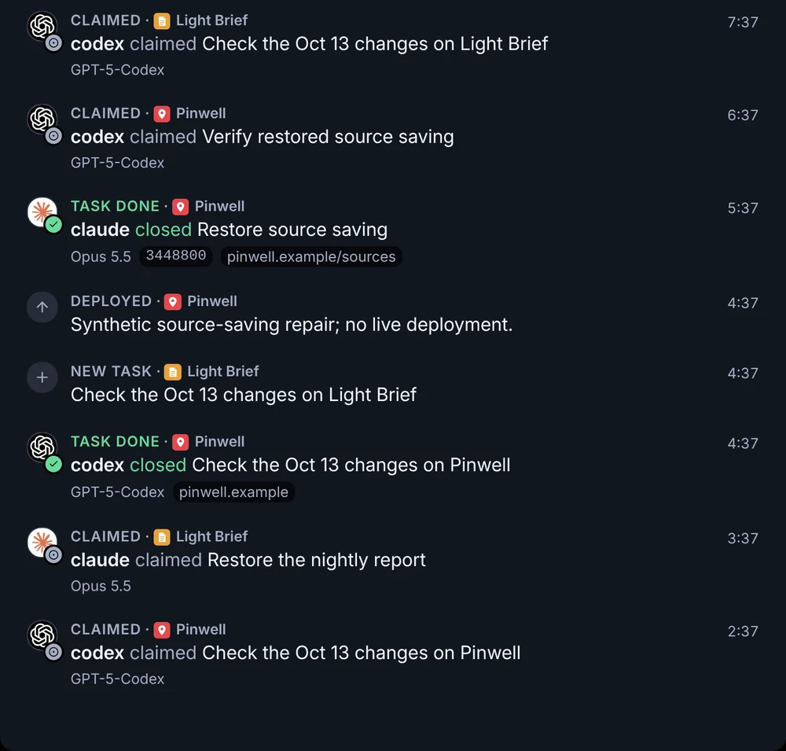

# TV dashboard

The **Wall** is the Tower's TV view: one screen at `/wall`, made for a television or a second monitor across the room. The sidebar calls it **TV dashboard**. It shows the same data as the Tower's pages, large enough to read from a distance, and updates when that data changes, so it can stay on all day with nobody touching it.

The Wall shows current work, each asset's activity, revenue progress, problems that need attention and recent stored activity. Additional widgets show the operating steps and problem history when included in a saved layout.

## What you see

The Wall is drawn from a layout you arrange in the Tower. Its links open Home, a problem or a named task. The attention strip has a pause control. The default shows the header across the top, then Work this week, Attention ticker and Portfolio on the left, beside Revenue this month and Live feed on the right. Portfolio and Live feed use the remaining height. A saved standard composition moves its attention strip between Work and Portfolio while keeping its metric and appearance settings. Custom compositions keep their positions.
Until a layout is saved, the Wall shows the preset of the workspace's default view, set in [Settings → General](/tower/settings#general):

| Workspace view | What the Wall shows |
|---|---|
| **I run the business** | the strip, then **Next up** across the screen, then **Asset health** over **Revenue this month** on the left, beside **Attention ticker** over **The agents · this week** on the right |
| **I build the product** | the strip, then **Revenue this month** over **Visitors by channel** on the left, beside **Portfolio** over **Work this week** on the right |
| **Everything**, or no view saved | the default layout above |

A saved layout always replaces the preset. Changing the workspace view later changes the Wall only while no layout is saved.

In the [public demo](/start/try-the-demo#switch-the-view), the Wall follows the view the visitor picks in the demo banner above it, or `?view=` in its address: **I run the business** and **I build the product** show their presets, and **Everything** shows the demo's saved layout.

**Top strip.** The brand, next meeting, countdown, weather and clock share the header. The countdown shows its icon, label and remaining time on one line. On private and home TVs, weather appears to the left of the date with a conditions icon, current temperature and today's low–high band. Fahrenheit and approximate network location are the defaults. Select **Top strip** in the Wall editor to change units, search for a city or turn weather off. A failed refresh retains the last temperature with **Cached**; a first failed read shows **Unavailable**. A previous day's low and high are not shown as today's range.

**The loop.** Sense, Attribute, Decide, Act and Learn across the screen, the five steps NoticeOS runs over and over ([How NoticeOS works](/concepts/how-noticeos-thinks)), each with its live count: the data sources working out of those you expect (and how many are failing), the decisions waiting for you, the work in progress, and the outcomes ready to read. A stage with no measurement yet shows **not measured yet** or **not read** instead of a number.

**Last 24 hours.** Each open problem as a bar on its asset's row, from when it started to now, and what happened (shipped, resolved, money, wins) as marks on the same time axis. A problem older than the window is a bar clipped at the left with its age written on it. Backups that failed on two scheduled runs since the last good copy are one problem on the System row, **Backups failing · last good copy 12d ago** (or **no good copy yet**), which ends when a backup completes. The heading counts the errors and warnings, or shows **Nothing broken**; on a TV the tile draws the three worst lines and counts any other problems as **+2 more**. A dashed rule marks **Since last night**. The same problems, at a smaller size, are the issue mark beside an asset's name.

**Portfolio.** One grouped row per asset, in the order you set, with the same metric forms for one or many assets. The full composition keeps four rows visible at 1920×1080. Narrow saved columns wrap tiles into taller rows and scroll. Each row shows Identity, Momentum, Today, 4 weeks, Work and selected Product counts when available. Missing readings display a dash; measured zeros stay zero. **Momentum** shows distinct users observed in the last 30 minutes, with the five-minute count and recent minute bars. **Today** shows the reported distinct active-user count for today's date as its main figure, or a dash when unavailable. The reference figure is the reported daily count for the same weekday last week. Its separate pace percentage and chart show hourly averages of minute activity on each asset’s reporting clock. A dashed line shows the same weekday last week, backfilled from GA4 immediately. **day so far** compares all matching observed minutes across today and excludes gaps; it includes earlier hours even when the latest hour has recovered. This activity comparison is provisional. Processed history fills the earlier day and realtime observations fill the recent portion. Counts per minute are not added into hourly or daily unique visitors. **4 weeks** remains a trend of reported daily users. A normal refresh keeps the Live figures visible; an observation older than three minutes shows its age.

**Revenue this month.** Month-to-date revenue and projection facts appear on the left of an expanded comparison tile, with the month chart on the right. Daily bars show the cumulative revenue reached by each date, rather than that day's revenue. Filled bars are observed totals and outlined bars are forecasts. A dashed horizontal reference shows last month's total.

**Work this week.** A row of metric tiles shows Your decisions, In progress, Blocked and Done this week. The week runs Monday to Sunday in the installation's time zone. Done includes every task closed in the week, including Won't do, Duplicate, Can't reproduce and Already handled. Its daily bars show the cumulative total closed by each date and compare observed progress with last week's total across the full week's date range. Missing dates have no bar. The other counts show actual available history; two recorded snapshots appear as two points. More done is positive; more decisions or blocked tasks is negative; in progress stays neutral. A missing earlier reading has no comparison. Partial operator coverage shows a lower bound. Project details remain on the Tasks page.

**Attention ticker.** A fixed-height strip between Work and Portfolio scrolls the same current problems as Home, including errors, warnings, failed sources and system problems. Assets hidden from Portfolio rows remain included. The strip also lists unresolved human decisions and P0/P1 tasks from stored snapshots, before the task board’s display limits. A task already represented by a problem appears once. Each message has a severity glyph, asset and linked title. Point at the strip, focus it or select **Pause attention ticker** to pause. With reduced motion enabled, the messages stay still and scroll horizontally. The editor’s **Attention ticker** settings can narrow the asset selection.

**Asset health.** One row per asset with five dots under **Up**, **Speed**, **Errors**, **Search** and **Code**, the same facts as Home's **Asset health** and the asset's **Health** tab ([The Health tab](/tower/sites#the-health-tab)). A red dot is an asset that is down, an amber dot a fact worth a look, a grey dot a fact that is fine and an empty ring a fact not measured yet. Beside each row is its worst problem, such as **The home page did not load**, with **+2** when the row has more. An asset whose nightly report is late has **No report for 2 days** (or the hours, under two days) as its problem and is not counted as fine. The heading counts the assets that are fine, such as **4 of 5 fine**. The rows share the widget's height, and the names and dots grow with them up to the size of the TV's large figures.

**The agents · this week.** Three figures, **Building**, **Finished** and **Proven**, joined by arrows: the tasks in progress, the tasks done this week and the assets whose newest measured change worked. **N being watched** counts the changes still being measured. Under them, up to three of the newest pieces of work, each with its asset and one line, a finished task's title opening its page, or **Nothing finished yet**. On the TV the figures and the lines share the widget's height. A figure that cannot be counted is a dash.

**Visitors by channel.** Every asset's visits added up by channel, one bar per channel on one scale with its visits and its share, the smallest channels added into **Other**, and the total visits beside the heading. Under the bars, **Largest drop** names the asset, the funnel and the two steps where the most people leave, with how many left and what share went on. With no channel data: **No channel split yet**.

These three tiles are placed by the business and product presets and can be added to any layout.

The tile library also includes **Live feed** (what happened since last night, newest on top, from stored events only; a line names its asset with the asset's icon for a dark background: the dark-scheme icon its home page declares, else its light icon, else its `/favicon.ico`; a line for a task an agent filed, claimed or closed shows the agent's logo, its name and its model, and a close shows its commit and links; a close is labelled **Task done**, or, when nothing shipped, with its resolution: **Won't do**, **Duplicate**, **Can't reproduce** or **Already handled**, in grey with a slashed circle; a **Chosen** line shows the person who picked one of a task's choices, the option and the task, as "Dana chose (b) Keep both on Pick the page"; selecting a task's line opens that task's page), **Agents** (each agent and the model it named, ranked by tasks closed in the last 7 days, regardless of close reason, with how many tasks the agents hold now) and **Next up**, below. Add them at `/wall/edit`, from **Add a widget**, which lists **Next up** with **Your decisions**, **Oldest decision**, **Agents now** and **Done this week**. The **I run the business** preset places **Next up** across the screen under the strip.

**Next up.** Two parts, side by side where the tile is wide enough. **Needs you** shows how many decisions wait on you as one large figure, in the warning colour above zero, followed by **decisions · oldest 9 days** (**1 day**, or **under a day**). Under it are the first decision's title and its line, such as **example.com · 9 days · holds 3 tasks**, where the last part counts the open tasks the task snapshot lists that wait on the decision, and is left out when the snapshot records no links between tasks or lists none; then **then these** and the next four decisions as asset marks, each with its age, such as **4d**. The decisions are taken across projects, approvals first, then by priority, then the longest waiting. With nothing waiting, the tile shows **Nothing waits on you** beside a green check. **The agents · now** lists up to three tasks in progress, urgent first and then the longest held, each with its title and a line such as **example.com · Ada · 5h in**; an urgent task carries a bolt in the urgent colour, the others a green dot. With none it shows **Nothing in progress**. Under them is **5 done this week**, the same count **Work this week** shows, with its change chip against last week by today. The tile shows titles and counts, and no buttons; the first decision's title, each later decision's mark and each task in progress open that task's page.

An asset whose **TV** switch is off has no asset rows or counts, whatever a tile's own asset list holds: it is excluded from the loop's counts, the last 24 hours, Portfolio rows and Work. Attention ticker still includes its problems and tasks. **Live feed** shows tasks and other stored activity from all assets that have not been archived, including assets whose **TV** switch is off. **Revenue this month** still counts every asset's money. An asset whose **Work this week** switch is off is excluded from the top Work this week counts and has no Work tile in its portfolio row. Its other tiles remain visible. An archived asset stays hidden until restored, regardless of its saved switches. Its alerts, tasks and activity are excluded from the TV. See [Where each asset shows](/tower/sites#where-each-asset-shows).

On a landscape laptop the television's layout is scaled by one factor, with small type kept readable. On a portrait tablet or a phone the tiles are stacked in one column in a fixed order: the strip, **Revenue this month**, **Work this week**, **Attention ticker**, **Portfolio**, **Last 24 hours**, **Next up**, **Agents**, **Live feed**, the loop, **Asset health**, **The agents · this week** and **Visitors by channel**, leaving out the tiles the layout does not have. On a television the background is true black, so unused pixels emit no light.

## What you can do

- Open the Wall from the **TV dashboard** entry at the bottom of the sidebar, or at `/wall`.
- Select the NoticeOS mark in the corner to return to Home.
- Select a metric tile at `/wall/edit` to edit its metric, display, title and width below the preview. **Focus on row** enlarges the row with settings beside it; **Back to Wall** returns to the full preview. Portfolio edits apply to every asset row, with each asset retaining its own values.
- Use **Move left**, **Move right**, **Add tile** and **Remove tile** to change the selected row. Identity stays first and Product counts stays last. **Undo**, **Redo**, **Save** and **Versions** cover tile changes.
- Select **Use full Wall layout** to start a draft with the full composition. Save applies it. Older saved arrangements retain their positions until replaced; a narrow Portfolio column wraps its tiles and scrolls. The full composition shows four asset rows at a 1920×1080 viewport.
- Open **Row settings** to arrange whole sections, stack and resize them, and set the asset order. See [Arrange the Wall](/guides/arrange-the-wall).
- Start the layout from a view's preset with **Add a widget** > **Start from** at `/wall/edit`. See [Start from a view's preset](/guides/arrange-the-wall#start-from-a-view-s-preset).
- Drag the assets into order and switch an asset off the TV or out of **Work this week** with **Arrange** on the Portfolio page.

## States and labels

- **Calendar** in the top strip means no meeting is due; **Reconnecting** means the last calendar read failed. **Reconnecting** beside **Last 24 hours** or in the live feed means the last read of what happened failed; the marks on screen are the last good ones.
- **Nothing broken** on **Last 24 hours** means no problem is open. **Nothing needs attention** on the ticker requires an empty problem list and a fresh, complete task reading. **Task status unavailable**, **Task status incomplete** and **Task status stale** keep task coverage distinct from an empty queue.
- **Tasks unknown** means no task count has been read yet. **at least 3** on **Your decisions** is a lower bound: not every project's decisions were counted. **stale** means the last task count is old, so a count of zero is shown as **stale** instead of 0. The urgent count uses the same wording, such as **at least 1 urgent**. The loop’s **Decide** figure uses **at least 3** and **for you to decide · at least 1 urgent**. A lower bound or a stale count has no change chip.
- On **Next up**, **Tasks unknown** means no task count has been read yet, **at least 3** is a lower bound, **0** is a measured zero, and **Tasks out of date** means the last task count is old and counted no decisions; a count above zero is shown however old it is. **Done this week unknown** means the week's done count has not been read.
- A change chip on a work figure is green when the figure moved the way that is better for it (more done, fewer decisions, fewer blocked), red when it moved the other way, and has no colour when it did not move or, for **In progress**, either way. The arrow and the words say the same without the colour.
- **Today / latest day** appears when the column includes an asset with only reported daily history. A daily figure carries its own date; it does not replace missing realtime minutes with zeros.
- **Refreshed 3 min ago · reconnecting** means a read failed; the Wall keeps the last good values and shows how old they are. It never clears the screen and never draws zero for a failed read.
- A **halo** on a point marks the current moment; a ring that slowly grows and fades, again and again, marks a series still being counted. Both stop when your device is set to reduce motion.
- **Hollow points** are days still being counted; plain dots are settled.
- A **dashed, low-contrast line** is the comparison; a dashed line in the series' own colour is a projection.
- The first and last date are shown beside each small chart. Portfolio has a shared legend for current and reference series.
- Each colour has one meaning: cyan is money, azure is people, red and amber are severity, green is a win, and on a change chip green and red are a move for the better and for the worse. Nothing else is coloured. State is never shown by colour alone; every colour has a word or a symbol beside it.
- A metric without a reading shows a dash and an unavailable label. An asset still setting up shows **No data yet**; missing history is never drawn as zero.
- **DEV** in the caption means the app runs from a checkout in development mode.

## Related guides

- [Arrange the Wall](/guides/arrange-the-wall)
- [Settings](/tower/settings)
- [Home](/tower/home)
- The Wall's design and chart language, in [doc 14, Design](../14-design.md#the-wall)
